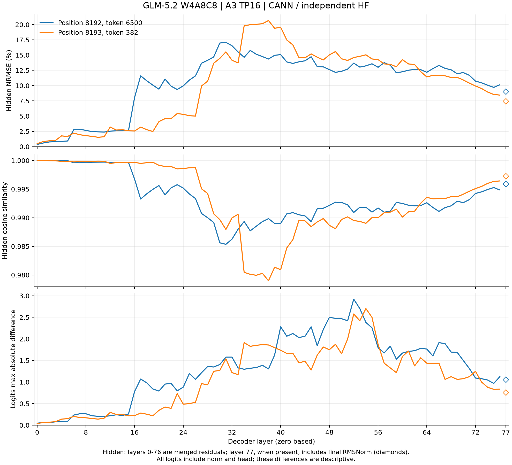

# HF diagnostics with oneDNN disabled

HF remains the primary independent diagnostic. The reference disables
oneDNN for prefix expansion, forward execution and diagnostic projections,
and retains the calibrated A3 Div arithmetic. The frozen CANN execution
uses the SwiGLU barrier overlay and FP32 TP reduction. Both paths use the
same W4A8C8 checkpoint, 8192-token prefix and consumed token 6500.

## Full 78-layer curves



Both teacher-forced positions, 8192/6500 and 8193/382, complete all 78
layers. HF passes 1,587/1,587 execution and exact reset checks. The first
five raw hidden states, selections and attention probabilities match the
five-layer run exactly; all five diagnostic logits also match exactly.

| Position / input | Peak hidden NRMSE | Minimum cosine | Final hidden NRMSE / cosine | Peak logits max-abs | Final logits max-abs / relative difference |
|---|---:|---:|---:|---:|---:|
| 8192 / 6500 | 0.170898, L31 | 0.985360 | 0.090432 / 0.995911 | 2.921875, L52 | 1.062500 / 0.031716 |
| 8193 / 382 | 0.206640, L38 | 0.978990 | 0.074282 / 0.997241 | 2.703125, L54 | 0.760742 / 0.025571 |

Relative logits difference is max-abs divided by the HF logits range.
Both final top-1 tokens agree, 382 and 262; intermediate head probes can
disagree. Layers 0–76 compare merged residuals; layer 77 includes final
RMSNorm on both sides. Its unnormalized CANN output was not captured.

The final HF logits have maximum magnitudes 23.75 and 23.125. Their BF16
spacing is 0.125, so a fixed 0.1 bound rejects even a single ULP at those
magnitudes. The diagnostics report relative differences and both top-1
margins instead of applying that bound. Hidden errors exhibit discrete
jumps, particularly L16–17 in the first position and L27/L34 in the
second. These peaks are not a measured rounding floor; no larger hidden
threshold is fitted to make the two trajectories pass. Complete curves
replace five-point extrapolation, and performance profiling proceeds
while these differences remain available for localization.

Minimum index overlap is 1966/2048 and 1971/2048. The largest mean HF
unmatched attention masses are 0.006678 at L33 and 0.005354 at L73;
their maximum head masses are 0.022761 and 0.019499. These are diagnostics,
not a claim that all changed selections carry negligible weight.

The [independent artifact audit](audit.json) recomputes all 156 curve
points using Python FP64 sums, verifies the frozen sources and HF traces,
and checks the five/full agreement. The updated all-rank comparator reads
16 ranks × two positions: 50,116 structural/execution checks pass;
16,160 numerical/selection observations have no pass/fail field. This
does not establish the eight-input, 32-step end-to-end acceptance gate.

Artifacts: [CSV](layer-curves.csv), [SVG](layer-curves.svg),
[values, reference configuration and input hashes](layer-curves.json).

## Five layers

The corrected HF forward and exact reset replay pass 59/59 execution and
replay checks. These checks establish reference repeatability; layer
differences below are diagnostics without pass/fail judgments.

| Layer | Hidden NRMSE | Cosine | Logits max-abs | Index overlap / 2048 | HF cutoff gap | HF unmatched mass, mean / max head |
|---|---:|---:|---:|---:|---:|---:|
| 0 | 0.003595 | 0.999994 | 0.046875 | 2048 | 0.359726 | 0 / 0 |
| 1 | 0.005956 | 0.999982 | 0.062500 | 2045 | 0.109863 | 0.000723 / 0.002174 |
| 2 | 0.007693 | 0.999970 | 0.062500 | 2045 | 0.212891 | 0.000746 / 0.002251 |
| 3 | 0.008050 | 0.999968 | 0.078125 | 2045 | 0.212891 | 0.000556 / 0.002369 |
| 4 | 0.008587 | 0.999963 | 0.078125 | 2045 | 0.212891 | 0.000199 / 0.001678 |

Layers 3 and 4 reuse layer 2's index selection and cutoff scores. Mass is
the sum of actual HF attention probabilities on HF-selected slots absent
from CANN's selection, reported across 64 heads. CANN probabilities were
not captured. Cutoff score gaps and probability mass have different units.

Both saved logits are BF16. Their maximum magnitudes are 8.5–8.875, with
spacing 0.0625; this five-layer result does not itself invalidate a 0.1
absolute bound by representability. Intermediate logits are norm/head
probes. Layer 4 uses its raw merged hidden and the same diagnostic
projection formula as the full model, rather than the truncated model's
final hidden boundary.

The [five-layer values and hashes](five-layer-curves.json) bind the raw
CANN/HF traces and generator sources. The original 70/80 result used the
falsified CPU matmul reference and supplies no acceptance conclusion.
The [plan](../../../plan.md#4-可独立验收) defines the frozen end-to-end
teacher trajectory gate.

## Reproduce

Run on `a3-gs:trt-asc`; these commands use CPU and frozen device outputs.
The full checkpoint and prefix remain on the server.

```bash
source /workspace/environment/activate.sh
task_root=/workspace/offline/hf-corrected-curves-20261017
source_root=$task_root/source-02
env TORCH_DEVICE_BACKEND_AUTOLOAD=0 OMP_NUM_THREADS=8 MKL_NUM_THREADS=8 \
  OPENBLAS_NUM_THREADS=1 PYTHONPATH="$source_root:$source_root/tests/glm52" \
  python "$source_root/tests/glm52/run_hf_reference.py" \
  --checkpoint /workspace/models/GLM-5.2-w4a8c8 \
  --output "$task_root/hf-five-replay" --layers 5 --tokens 6500 --generate 1 \
  --capacity 9344 --mla-preprocess prolog_v3 \
  --source-commit 91ec6bd+hf-no-onednn \
  --prefix /workspace/offline/prefix8k-allocation-20261017/capture/case-00/main-prefix
```

For all 78 layers, use `--layers 78 --tokens 6500 382` and a fresh output
directory. Exact reset checks remain enabled. Generate the three curves
with [the plotter](../../../../tests/glm52/plot_cann_hf_layers.py), using
`--native-run /workspace/offline/cann-full8k-barrier-20261017/continuation8k`
and the completed HF output as `--reference`.
