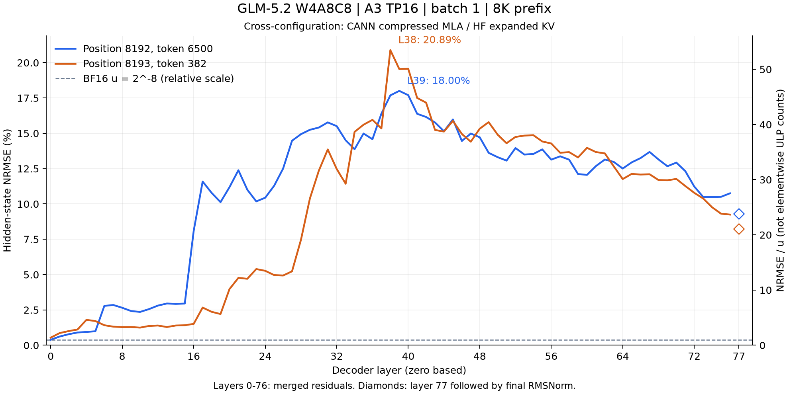

# Hidden-state differences across 78 decoder boundaries

This historical reference used the default CPU BF16 matmul provider.
Exact-dot-product evidence subsequently identified 417/1024 incorrect
BF16 results in its frozen PV witness; disabling oneDNN removes those
differences. These curves remain a record of the original run and do not
calibrate thresholds. The corrected reference retains Div calibration
and is compared with the same frozen CANN tensors.



This is a cross-configuration diagnostic: CANN compressed MLA versus the
independent HF expanded-KV reference, with the same W4A8C8 checkpoint,
captured 8K prefix and teacher inputs. The run uses `a3-gs:trt-asc`,
TP16, batch 1, the SwiGLU barrier overlay and FP32 TP reduction.

| Consumed position / token | Layer 0 | Peak | Layer 76 | Layer 77 + final norm |
|---|---:|---:|---:|---:|
| 8192 / 6500 | 0.38890% | 18.00430% at L39 | 10.75438% | 9.31897% |
| 8193 / 382 | 0.53628% | 20.89024% at L38 | 9.24998% | 8.24223% |

The curves rise through discrete jumps and later decline. Their peaks
are 46.09 and 53.48 times BF16 unit roundoff, `u = 2^-8`. They do not
remain at an approximately one-u floor; the shape alone does not establish
an exponential bias or identify an operator defect.

Layers 0–76 use merged residual outputs. The final diamond is the output
of layer 77 followed by final RMSNorm, matching the saved HF hidden-state
convention. Its raw pre-norm layer-77 output was not captured. NRMSE is
recomputed in FP64 as `||CANN - HF||₂ / ||HF||₂`; the CSV also retains the
original FP32 report values. `NRMSE / u` is a relative scale, not a count
of elementwise ULP differences. No acceptance threshold changes here.

The [full-run audit](../cann-full8k-barrier-20261017.json) verifies all
80 report/tensor files and 13 source files. Both steps have identical
hidden states across all 16 ranks. All 38,048 recorded reset checks pass;
the audit independently compares first/reset logits, all hidden states,
KV rows, selections, captured MoE stages and TP reduction samples exactly.
This establishes repeatability of that run, independently of its HF
differences. Native vLLM-Ascend deployment equivalence is a separate check.

Artifacts: [CSV](hidden-nrmse.csv), [SVG](hidden-nrmse.svg),
[input hashes and FP64 values](hidden-nrmse.json).

## Original command

The original plotter is preserved at commit `91ec6bd`. The current
[plotter](../../../../tests/glm52/plot_cann_hf_layers.py) requires the
corrected reference and produces three curves.

```bash
source /workspace/environment/activate.sh
git show 91ec6bd:tests/glm52/plot_cann_hf_layers.py > /tmp/plot_hf_legacy.py
TORCH_DEVICE_BACKEND_AUTOLOAD=0 python /tmp/plot_hf_legacy.py \
  --native-run /workspace/offline/cann-full8k-barrier-20261017/continuation8k \
  --reference /workspace/offline/cann-div-reference-20261017/hf-8k \
  --output /workspace/offline/cann-full8k-barrier-20261017/layer-curves-new
```
