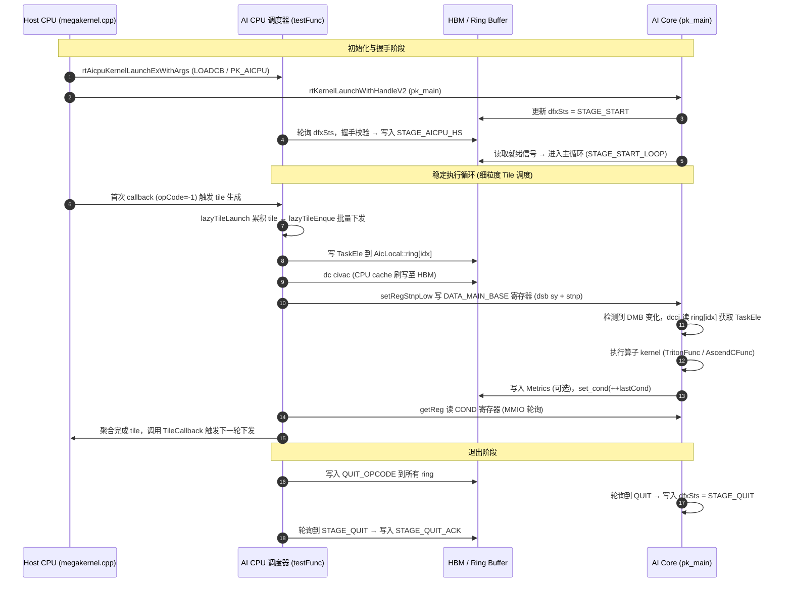

# Ascend kernel-launch overhead and cross-core synchronization — internal-wiki source material

> SOURCE WARNING: every item in this file comes from `wiki.huawei.com` (Huawei internal Wiki),
> fetched 2026-10-20 via the vibe-km / wiki-mcp tool. It is internal material. Do not publish
> this file or push it to a public remote. Each item carries its exact Wiki URL, knowledge-base
> name and document ID so provenance is traceable.

Companion to `ascend-fusion-mechanics.md` (public/CANN-doc sources). This file holds the two
things public sources do not give us: (a) a measured breakdown of where a kernel's head
overhead actually goes on Ascend, and (b) the real cross-core synchronization code and its
hard limits.

Our measured numbers these bear on: per-call floors AI_VECTOR_CORE 0.70 us, AI_CORE 2.30 us,
MIX_AIV 12.04 us, MIX_AIC 13.58 us; ~3008 kernels/round giving an 11.5 ms launch floor with
82% on MIX; 505 MIX_AIC calls a round (6.5 per layer); MlaPrologV3 2.950 ms vs 2.745 ms of
bytes (the only op at the bandwidth bound).

---

## 1. MIX 算子头开销分析 — the decomposition of a MIX kernel's launch cost

URL: https://wiki.huawei.com/domains/68949/wiki/232736/WIKI202509048148802
Knowledge base: 基础软件开发部
Doc ID: WIKI202509048148802

This is the single most directly relevant document found. It starts from exactly our symptom:
a quantized MatMul (a MIX operator, because quantization pulls in the V core) is *slower*
end-to-end than the non-quantized MatMul, despite executing faster.

### 1.1 Setup and the comment-out method

> 此项分析的起因是存在客户超小shape M/K/N 1-4096-512，pertoken+perchannel量化
>
> 量化的matmul E2E耗时反而比量化低，量化mamtul为MIX算子，相较于非量化matmul额外启动了V核
>
> ## 软件测注释代码实验
>
> 首先通过在Kernel中注释掉业务无关代码，保留各种初始化。拆解出Kernel执行时间和Overhead

```cpp
kernel.init()
kernel.Process()

void Process(){
    // 一些必须的反向同步flag
    SET
    SET
    // for (int i = 0; i < _loopi; i++) {
    //     CopyIn(i)
    //     Compute(i)
    //     CopyOut(i)
    // }
    WAIT
    WAIT
}
```

> 使能不同和核数，比较量化matmul和非量化matmul耗时
>
> E2E定义：不更改任何代码的执行时间
>
> Overhead定义: 注释掉Kernel真正执行的部分后，使用msprof op抓到底duration即为overhead
>
> execute定义：All - Overhead

### 1.2 The measured table — overhead vs execute vs E2E by core count (us)

> | # AIC Cores | 2 | | 4 | | 8 | | 16【业务场景】 | |
> | --- | --- | --- | --- | --- | --- | --- | --- | --- |
> |  | 量化 | 非量化 | 量化 | 非量化 | 量化 | 非量化 | 量化 | 非量化 |
> | overhead | 4.14 | 1.08 | 4.48 | 1.42 | 5.64 | 1.42 | 9.24 | 2.16 |
> | execute | 11.7 | 24.24 | 6.78 | 13.16 | 4.76 | 8.44 | 3.34 | 5.28 |
> | E2E | 15.84 | 25.32 | 11.26 | 14.58 | 10.4 | 9.86 | 12.58 | 7.44 |
>
> ### 结论一：执行时间上量化算子收益符合预期
>
> ### 结论二：16核时overhead接近执行时间的3倍，为主要耗时

### 1.3 ESL-model decomposition of the overhead, and the verdict

> 后续了解到Overhead的具体分段，参考David上的头开销统计实验，<https://wiki.huawei.com/domains/3822/wiki/40944/WIKI202504306724804>，在1971上重复该实验
>
> ### 先放结论，硬件无法优化，软件无通用优化
>
> 用满24核情况下
>
> - **硬件总开销 4us 无法优化**
>   - 调度开销 -> 【0， 硬件启动】
>   - 启动开销 -> 【硬件启动， 硬件启动结束】
> - 软件总开销
>   - Kernel Args预取 ->【硬件启动结束， 核函数入口处插桩】**2.46us, 无法优化**
>   - Tiling 拷贝 ->【核函数入口处插桩， TilingData拷贝结束插桩】**2.3us**
>   - 其他软件开销->【TilingData拷贝结束插桩， 第一条MTE2启动】**1.3us**
>
> Tiling拷贝核其他软件开销理论上能够被MTE2掩盖，算子层的优化思路为尽可能早的拉起第一条mte2，也分类讨论
>
> - 使用静态场景， 3.6->1.1us
> - 动态场景下采用JIT模式 （要求更快的kernel编译速度，同shape下 kernel cache机制，快速的更新/查找cache（查找cache速度要做到2.5us以内才能有收益）
> - 初始化/tiling copy “Lazy”模式，随用随做，但实际改变了编程模型，并不通用

### 1.4 Const-shape scenario — overhead scales with core count (us)

> Const场景
>
> |  | 调度开销 | 硬件启动开销 | kernel args预取 | Tiling拷贝 | 其他软件开销 | 硬件总开销 | 软件总开销 | 总开销 |
> | --- | --- | --- | --- | --- | --- | --- | --- | --- |
> | 1 | 1.150555556 | 0.823333333 | 0.585 | 0.040555556 | 0.836111111 | 1.973888889 | 1.461666667 | 3.435555556 |
> | 4 | 1.150555556 | 1.106666667 | 0.853888889 | 0.038333333 | 0.751666667 | 2.257222222 | 1.643888889 | 3.901111111 |
> | 8 | 1.150555556 | 1.427777778 | 1.068333333 | 0.038333333 | 0.832777778 | 2.578333333 | 1.939444444 | 4.517777778 |
> | 16 | 1.150555556 | 2.155555556 | 1.61 | 0.038333333 | 0.780555556 | 3.306111111 | 2.428888889 | 5.735 |
> | 24 | 1.150555556 | 2.833888889 | 2.269444444 | 0.037222222 | 1.098333333 | 3.984444444 | 3.405 | 7.389444444 |

### 1.5 Dynamic-shape scenario (us) — tiling copy explodes

> Dyn场景
>
> |  | 调度开销 | 硬件启动开销 | kernel args预取 | Tiling拷贝 | 其他软件开销 | 硬件总开销 | 软件总开销 | 总开销 |
> | --- | --- | --- | --- | --- | --- | --- | --- | --- |
> | 1 | 1.150555556 | 0.836111111 | 0.575 | 0.422777778 | 1.330555556 | 1.986666667 | 2.328333333 | 4.315 |
> | 4 | 1.150555556 | 1.129444444 | 0.771666667 | 0.528333333 | 1.330555556 | 2.28 | 2.630555556 | 4.910555556 |
> | 8 | 1.150555556 | 1.450555556 | 1.238333333 | 1.529444444 | 1.31 | 2.601111111 | 4.077777778 | 6.678888889 |
> | 16 | 1.150555556 | 2.181111111 | 2.27 | 2.845 | 1.311666667 | 3.331666667 | 6.426666667 | 9.758333333 |
> | 24 | 1.150555556 | 2.846666667 | 2.461111111 | 2.293333333 | 1.312222222 | 3.997222222 | 6.066666667 | 10.06388889 |

### 1.6 ESL simulation vs real measurement for the 16-core business case (us)

> ESL 仿真 16core 业务场景
>
> |  | 调度开销 | 硬件启动开销 | kernel args预取 | Tiling拷贝 | 其他软件开销 | 硬件总开销 | 软件总开销 | 总开销 |
> | --- | --- | --- | --- | --- | --- | --- | --- | --- |
> | 量化 | 1.150555556 | 2.181111111 | 2.27 | 2.845 | 1.311666667 | 3.331666667 | 6.426666667 | 9.758333333 |
> | 非量化 | 1.150555556 | 1.972777444 | 0.885315648 | | | 3.123333 | 0.885315648 | 4.008648648 |
>
> 业务实测
>
> |  | 调度开销 | 硬件启动开销 | kernel args预取 | Tiling拷贝 | 其他软件开销 | 总开销 |
> | --- | --- | --- | --- | --- | --- | --- |
> | 量化 | 6.18 | | | 3.38 | 0.5 | 10.06 |
> | 非量化 | 1.84 | | | 0.22 | 0.1 | 2.16 |
>
> 当代可能的业务优化方向：
>
> 尽可能使用静态场景
>
> Lazy初始化，尽可能早的发射第一条MTE2指令
>
> 下一代芯片数据：
>
> 硬件方面：
>
> 调度，硬件启动优化
>
> 软件方面：
>
> 同地址访问冲突影响降低
>
> 核数从72->96个的场景下，头开销优化20%左右

## Relevance

This is the mechanism behind our MIX_AIC 13.58 us / MIX_AIV 12.04 us floors versus
AI_VECTOR_CORE 0.70 us. The measured split at 24 cores is: 4 us irreducible hardware
(scheduling 1.15 us + hardware start 2.83 us), 2.46 us kernel-args prefetch declared
unoptimizable, 2.3 us TilingData copy, 1.3 us other software before the first MTE2 issues.
Two numbers matter most for us. First, every component except 调度开销 (flat at 1.15 us)
grows with the number of cores engaged — hardware start goes 0.82 → 2.83 us and args prefetch
0.585 → 2.27 us from 1 to 24 cores — so a megakernel that occupies all cores once per round
pays this *once* instead of 3008 times. Second, const (static) shape kills the TilingData
copy entirely (0.038 us vs 2.845 us at 16 cores); our batch=1 specialization means every
shape is static, so the "3.6 → 1.1 us" static-scenario win is available to us by
construction. The document's own conclusion — "硬件无法优化，软件无通用优化", with the only
listed levers being static shapes and getting the first MTE2 out as early as possible — is
the argument that per-op tuning cannot reach our target and the launch count itself must fall.

---

## 2. 头开销统计方法 + 实测数据 — how the segments are measured, and per-SoC numbers

URL: https://wiki.huawei.com/domains/3822/wiki/40944/WIKI202504306724804
Knowledge base: 昇腾算子
Doc ID: WIKI202504306724804

### 2.1 The measurement recipe (how to reproduce the segmentation ourselves)

> ### 1. 头开销统计方法
>
> 头开销分段 （引自<https://onebox.huawei.com/v/0a0f2cc0537670c721d0708c77ede234?type=0>）
>
> esl model 生成的日志中，以上各段的统计方法：
>
> - 调度开销
>   起点：在/log\_ca/stars\_log0\_0.dump中首次出现“swapin to ACSQ” 的为stars 调度起点；
>   终点：首次"Submit request to"出现行的cycle为调度开销的终点，该文件中的cycle数的频率task\_schedule\_clk\_freqency(<https://wiki.huawei.com/domains/3822/wiki/12652/WIKI202312192584161)>, 转换到芯片主频下的cycle要乘1.65.
> - 硬件头开销
>   起点：有预热跑ttk 时，是++++上一行的cycle数；无预热时，是log\_ca/core0.cubecore0.su\_pmu\_log.dump"中首行的cycle，对比发现这个起点基本等于调度开销终点。
>
>     终点：有预热跑ttk 时，是++++下一行的cycle数；无预热时，是log\_ca/core0.cubecore0.su\_pmu\_log.dump中首次出现"single issue\_instr"的cycle或者
>
>  "/log\_ca/core0.cubecore0.instr\_popped\_log.dump"首行的cycle数。[ps: 测试过程中发现，在指定manual\_block\_dim后，如果加ttk预热跑用例，从stars log 中可以看到所有的和都有启动，不带预热跑（--model-warmup=false），才会只启动指定核数]
>
> - 软件头开销
>   起点为硬件头开销终点；
>   终点为 "/log\_ca/core0.cubecore0.instr\_popped\_log.dump"中首次MTE2搬运出现的cycle。
>   tilingcopy 的起点和终点可在kernel中GET\_TILING\_DATA函数调用的前后set\_mark打点，得到相应的时刻。

### 2.2 Per-SoC head overhead, and the -c vs -d (const vs dynamic) comparison

> ### 2. 实测数据
>
> 对v100, v120, v121 测试了各个量化模式（pertensor, mxf8, mxfp4, pertoken,perblock）下，启动不同核数(1, 4, 8, 12, ..., 32/54)的qbmm 算子头开销.
>
> #### 0. -d 和-c 模式头开销对比
>
> -d 模式主要有调度开销，硬件启动， 核参数复制，tiling data复制，其他软件初始化五个阶段耗时。-c模式和-d相比， 调度开销和硬件启动耗时无明显变化， tiling data 复制耗时几乎没有了，其他软件初始化耗时也有所降低。下图以v120 pertensor量化模式的-c -d 头开销对比， 其他场景的-c -d 有类似的规律。
>
> #### 1. v100 各量化模式头开销
>
> 调度头开销个量化模式，不同核基本相等约0.46us，硬件启动开销个量化模式不同核基本在1.70到1.89us 之间波动。
>
> #### 2. v120 各种量化模式头开销
>
> 调度头开销个量化模式，不同核基本相等约0.53us，硬件启动开销个量化模式不同核基本在2.0到2.15us 之间波动。
>
> #### 3. v121 各种量化模式头开销
>
> 调度头开销个量化模式，不同核基本相等约0.37us，硬件启动开销个量化模式不同核基本在1.10到1.28us 之间波动。

## Relevance

Gives us a reproducible procedure for attributing our own 13.58 us MIX_AIC floor to segments
(stars_log "swapin to ACSQ" → "Submit request to" for scheduling; su_pmu_log first
"single issue_instr" for hardware start; instr_popped_log first MTE2 for software head;
set_mark around GET_TILING_DATA for the tiling copy). The note that `--model-warmup=false` is
required or all cores appear started is a trap to avoid when we instrument. The per-SoC
scheduling overhead (v100 0.46 us, v120 0.53 us, v121 0.37 us) and hardware start
(1.70–1.89 / 2.0–2.15 / 1.10–1.28 us) are the floor-of-the-floor: a megakernel pays one of
these per round, 3008 kernels pay 3008.

---

## 3. 【典型编码问题-案例13】— the CrossCoreSetFlag counter limit, and MlaPrologV3's real CV pipeline

URL: https://wiki.huawei.com/domains/104592/wiki/240629/WIKI202601129756471
Knowledge base: 创新算子部
Doc ID: WIKI202601129756471
Title: 【典型编码问题-案例13】流水设计要考虑跨核同步的嵌套深度（同一flagId的计数器最多设置15次），避免连续CrossCoreSetFlag\CrossCoreWaitFlag的情况
Origin: 龙猫mla prolog支持cv 1:1需求; 问题单 DTS2025123130366

Two things at once: the hard hardware limit on consecutive cross-core flag sets, and the
actual internal dataflow of MlaPrologV3 — the one op we measured at the bandwidth bound.

### 3.1 The bug and the root cause — 15 is the counter limit

> # 描述
>
> mlaprologV3 量化场景，CV1:1 控核8:8，概率出现卡死
>
> B为160，,N1为128
>
> # 根因
>
> prolog 量化场景，原流水设计有缺陷，在N较大场景，MatmulQcQrSyncDequant可能出现**CrossCoreSetFlag连续多次执行。**
>
> cv1:1, V核处理全量数据，V处理慢，C等V的时间变长，如果同步信号连续执行的次数超出计数器限制（同一flagId的计数器最多设置15次），会导致卡死。 --> 为啥是概率出现 非必现？因为V处理时长和硬件性能、负载有关。

### 3.2 MlaProlog's compute + CV pipeline, verbatim from the kernel comment

```markdown
/*
 * MlaProlog算子计算&CV流水同步流程
 *                    ┌───────────────── token_x ─────────────────┐
 *                    |                                           ▼
 *                    |                                      MatmulCkvKr
 *                    ▼                                           | wait mm CkvKr(0x1)
 *                MatmulCq                                        ▼
 *                    | wait mm Cq(0x1)                  ┌─────────────────┐
 *                    ▼                                  ▼                 ▼
 *               RmsNorm(Cq)                         RmsNorm(Ckv)       Rope(Kr)
 *                    | wait rmsNorm cq(0x1)             |                 |
 *                    ▼                                  ▼                 ▼
 *        ┌───────MatmulQcQr───────┐                 Scatter(Ckv)      Scatter(Kr)
 *        | wait mm Qc(0x1)        |                     |                 |
 *        ▼                        |                     ▼                 ▼
 *    DequantQc                    |                 kv_cache_out      kr_cache_out
 *        | wait dequant qc(0x1)   | wait mm Qr(0x2)
 *        ▼                        ▼
 *     MatmulQn                 Rope(Qr)
 *        | wait mm Qn(0x1)        |
 *   DynamicQuantQn──┐             |
 *        |          ▼             |
 *        ▼   dequant_scale_out    ▼
 *    query_out               query_rope_out
 */

 MatmulCq ---> RmsNorm(Cq) ──> MatmulQcQr ──> MatmulQn
                                          └──> Rope(Qr)
```

### 3.3 The actual AIC / AIV code structure with every flag

> **整体循环：**
>
> // BS合轴
>
> for (int64\_t batchOffset = 0; batchOffset < bsSize; batchOffset += static\_cast<int64\_t>(baseParams\_->stepBatchSize)) {   // **stepBatchSize = min(128U, tSize)=min(128, bs) = 128**
>
> AicProcess
>
> AivProcess
>
> }
>
> **C核处理：**
>
> AicProcess
>
> -> MatmulSplitN // Qc
>
> -> **CrossCoreSetFlag<SYNC\_MODE\_CUBE\_VEC, PIPE\_FIX>(FINISH\_MM\_CQ)**
>
> **-> CrossCoreWaitFlag(FINISH\_VEC\_RMSNORM\_CQ)**
>
> -> MatmulAndSyncQcQr // QcQr
>
> --> MatmulQcQrSyncDequant
>
> --->  for (int64\_t nL1 = 0; nL1 < nL1loops; nL1++) {   // nL1loops=n/baseN = **24次循环, 因为N轴（128\*24）比较大，切N**
>
>              MatmulSplitK() // QcQr MM
>
> **CrossCoreSetFlag<0x2, PIPE\_FIX>(FINISH\_MM\_QCQR\_SPLIT\_N)     // 细粒度流水同步**
>
> -> MatmulQnSyncDynamicQuantAndMulQr
>
> --> for (int64\_t i = 0; i < subLoopTimes; i++) // subLoopTimes=headNum/核数=128/8=16
>
> **CrossCoreWaitFlag(FINISH\_VEC\_DEQUANT\_QC\_SPLIT\_N);**
>
> MatmulFullLoad（）
>
> **CrossCoreSetFlag<SYNC\_MODE\_CUBE\_VEC, PIPE\_FIX>(FINISH\_MM\_QN\_SPLIT\_N);**
>
> **V核处理:**
>
> AivProcess
>
> -> **CrossCoreWaitFlag(FINISH\_MM\_CQ)**
>
> -> RmsNormCq
>
> -> **CrossCoreSetFlag<SYNC\_MODE\_CUBE\_VEC, PIPE\_MTE3>(FINISH\_VEC\_RMSNORM\_CQ)**
>
> -> DequantAndRopeSplitNSyncMMQcQr
>
> --> for (int64\_t nL1 = 0; nL1 < nL1loops; nL1++) {   // nL1loops=n/baseN = **24次循环，和headNum和核数有关**
>
> **CrossCoreWaitFlag(FINISH\_MM\_QCQR\_SPLIT\_N);**
>
> **DequantQcQrSplitN** // 尝试将 DequantQcQrSplitN的处理数据量降为一半，无卡死，说明和V核处理效率有关
>
> **CrossCoreSetFlag<SYNC\_MODE\_CUBE\_VEC, PIPE\_MTE3>(FINISH\_VEC\_DEQUANT\_QC\_SPLIT\_N)**
>
> **RopeQrSplitN**();
>
> -> DynamicQuantQnAndMulQrSyncMMQn
>
> -->  for (int64\_t loopIdx = 0; loopIdx < mmQnLoops; loopIdx++) {  // per-head循环, mmQnLoops =headNum/核数=128/8=16
>
> --->  **CrossCoreWaitFlag(FINISH\_MM\_QN\_SPLIT\_N)**
>
> --->  DynamicQuantQnWithMulQr
>
> 其中,
>
> n = singlecoreHeadSizeQcQr\_ = 单核处理的QcQr维度， **8核**，**nSize**\*(Dc+Dr)=128\*(128+64)=128\*192,  所以 n=128\*192/8核=128\*24
>
> baseN=128
>
> nL1Loops = n/baseN = 24

### 3.4 Fix and the fine-grained-pipeline tradeoff, verbatim

> # 解决方案
>
> MatmulQcQrSyncDequant 的跨核同步，处理一块同步一次（单次循环对应一次crossCoreSetFlag\crossCoreWaitFlag）改为处理2块或3块同步一次，减少连续同步次数，降低同步计数器累加深度。
>
> 注：本身QcQr SplitN的细粒度流水是为了提升性能，相较于不做细粒度控制的流水，能做到更小块粒度的并行
>
> 1）做了细粒度流水控制：cv并行粒度更小
>
> MatmulCq ---> RmsNorm(Cq) ──> MatmulQcQr\_1 ──> MatmulQcQr\_2 -> MatmulQcQr\_3 ->MatmulQcQr\_4 ->MatmulQcQr\_5 ->MatmulQcQr\_6 ->.... -> MatmulQn\_1 -> MatmulQn\_2 -> MatmulQn\_3 ...
>
>                 └──> dequant\_1 --> Rope(Qr)\_1  --> dequant\_1 --> Rope(Qr)\_1 ....
>
> 2）如果不做细粒度流水控制：相当于cv串行
>
> MatmulCq ---> RmsNorm(Cq) ──> MatmulQcQr  ---------------------------------> MatmulQn
>
>                                                                                    └──> dequant --> Rope(Qr)
>
> # 改进
>
> **1、流水设计要考虑同步信号的队列深度（同一flagId的计数器最多设置15次），避免某流水连续CrossCoreSetFlag\CrossCoreWaitFlag的情况，易出现卡死**

## Relevance

Three load-bearing facts for a megakernel. (1) Hard limit: the same flagId's counter saturates
at 15 outstanding sets; a persistent kernel that fine-grains its AIC→AIV handoff per tile will
deadlock, non-deterministically, as soon as the consumer falls 16 tiles behind. Our MoE
megakernel would do exactly this (128 per-rank intermediate columns, 8 active experts), so we
must either coarsen (the fix here: sync every 2–3 blocks) or rotate flagIds. (2) MlaPrologV3's
internals are now visible: MatmulCq → RmsNorm(Cq) → MatmulQcQr → {DequantQc → MatmulQn →
DynamicQuantQn, Rope(Qr)} on one branch, MatmulCkvKr → {RmsNorm(Ckv) → Scatter(Ckv), Rope(Kr) →
Scatter(Kr)} on the other, all inside a single BS-fused loop with stepBatchSize=min(128, bs).
This is *already* a megakernel for one stage, and it is the one op we measured at 1.1x of its
bandwidth bound — strong evidence that the pattern works on Ascend and that the remaining ops'
2.9x–30x ratios are launch, not hardware. (3) The fine-vs-coarse pipeline diagram is the
explicit statement that without per-tile cross-core flags, CV execution degenerates to serial —
which is what we must avoid when we coarsen to dodge the counter limit.

---

## 4. 流水同步汇总 (CANN) — the complete synchronization primitive inventory

URL: https://wiki.huawei.com/domains/147846/wiki/296159/WIKI2026042810941342
Knowledge base: CANN
Doc ID: WIKI2026042810941342

A full audit of the sync primitives in the conv3d backprop MIX kernels. Useful as the
authoritative inventory of *what sync mechanisms exist at all* and their event-id budgets.

### 4.1 Cross-core flag constants, as defined in real kernel source

> ### 1.1 FLAG常量定义 (conv_bp_sub_func_mix.h:30-35)

```cpp
constexpr uint8_t FLAG_MTE1_ID_1 = 6;      // MTE1流水线flag 1, Vector核数据加载同步
constexpr uint8_t FLAG_MTE1_ID_2 = 7;      // MTE1流水线flag 2, Group/C04场景同步
constexpr uint8_t FLAG_FIXP_ID = 8;       // FIX流水线flag, SplitDk/KernelSplit场景
constexpr uint8_t FLAG_MTE2_VEC_ID = 9;   // MTE2→Vector同步, SplitDk/KernelSplit场景
constexpr uint8_t SYNC_MODE = 4;
constexpr uint8_t CROSS_CORE_FLAG_ID_MAX = 16;  // 扩展flag偏移, C04双buffer场景
```

### 4.2 The base cross-core wrapper — note the arch-5102 divergence

> #### 5. 基础跨核同步封装 (conv_bp_sub_func_mix.h:125-143)

```cpp
template <class Intf, pipe_t srcPipe, pipe_t dstPipe>
__aicore__ inline void CvCrossCoreSet(Intf *self, uint8_t flagId)
{
#if (__NPU_ARCH__ == 5102)
    AscendC::TQueSync<srcPipe, dstPipe> sync;
    sync.SetFlag(flagId);
#else
    CrossCoreSetFlag<SYNC_MODE, srcPipe>(flagId);
#endif
}

template <class Intf, pipe_t srcPipe, pipe_t dstPipe>
__aicore__ inline void CvCrossCoreWait(Intf *self, uint8_t flagId)
{
#if (__NPU_ARCH__ == 5102)
    AscendC::TQueSync<srcPipe, dstPipe> sync;
    sync.WaitFlag(flagId);
#else
    CrossCoreWaitFlag<SYNC_MODE, dstPipe>(flagId);
#endif
}
```

### 4.3 Cube↔Vector notify/wait pairs — where each one is called

> #### 1. KernelSplit场景专用函数 (conv3d_bp_kernel_split_func.h:341-388)

```cpp
// Cube通知Vector - GetTensorC后调用
template <class Intf>
__aicore__ inline void CrossCoreCSeitVForKS(Intf *self)
{
#ifndef __CCE_KT_TEST__
    if (self->ctx.needComputeFlag_) {
        if (self->ctx.kSUseWorkSpace_) {
            CvCrossCoreSet<Intf, PIPE_FIX, PIPE_MTE2>(self, FLAG_MTE2_VEC_ID);  // workspace方案vec首指令为MTE2
        } else {
            CvCrossCoreSet<Intf, PIPE_FIX, PIPE_V>(self, FLAG_MTE2_VEC_ID);
        }
    }
#endif
}

// Cube等待Vector - GetTensorC前调用
template <class Intf>
__aicore__ inline void CrossCoreCWaitVForKS(Intf *self)
{
#ifndef __CCE_KT_TEST__
    if (self->ctx.needComputeFlag_) {
        CvCrossCoreWait<Intf, PIPE_MTE3, PIPE_FIX>(self, FLAG_FIXP_ID);
    }
#endif
}

// Vector通知Cube - VecPostProcess后调用
template <class Intf>
__aicore__ inline void CrossCoreVSeitCForKS(Intf *self)
{
#ifndef __CCE_KT_TEST__
    if (self->ctx.needComputeFlag_) {
        CvCrossCoreSet<Intf, PIPE_MTE3, PIPE_FIX>(self, FLAG_FIXP_ID);
    }
#endif
}

// Vector等待Cube - VecPostProcess前调用
template <class Intf>
__aicore__ inline void CrossCoreVWaitCForKS(Intf *self)
{
#ifndef __CCE_KT_TEST__
    if (self->ctx.needComputeFlag_) {
        if (self->ctx.kSUseWorkSpace_) {
            CvCrossCoreWait<Intf, PIPE_FIX, PIPE_MTE2>(self, FLAG_MTE2_VEC_ID);
        } else {
            CvCrossCoreWait<Intf, PIPE_FIX, PIPE_V>(self, FLAG_MTE2_VEC_ID);
        }
    }
#endif
}
```

### 4.4 The AIV-internal-then-cross-core idiom (notice the three-step)

> #### 7. VecTrans场景AIV通知AIC (conv3d_backprop_input_v2_vec_transpose.h:213-225)

```cpp
__aicore__ inline void VecNotifyCube()
{
#if (__NPU_ARCH__ == 5102)
    ffts_cross_core_sync(PIPE_MTE3, GetffstMsg(0x0, SYNC_AIV_AIC_DET_FLAG));
    wait_flag_dev(PIPE_MTE3, SYNC_AIV_AIC_DET_FLAG);
    AscendC::TQueSync<PIPE_MTE3, PIPE_MTE2> sync;
    sync.SetFlag((event_t)SYNC_AIV_AIC_DET_FLAG);
#else
    CrossCoreSetFlag<SYNC_MODE0, PIPE_MTE3>(SYNC_AIV_ONLY_ALL_DET_FLAG);
    CrossCoreWaitFlag(SYNC_AIV_ONLY_ALL_DET_FLAG);
    CrossCoreSetFlag<SYNC_MODE2, PIPE_MTE3>(SYNC_AIV_AIC_DET_FLAG);
#endif
}
```

### 4.5 Hardware (intra-core pipe) event types, dynamically allocated

> ### 4.1 动态获取方式
>
> 大部分硬件事件同步使用动态获取event_id：

```cpp
event_t eventId = static_cast<event_t>(GetTPipePtr()->FetchEventID(HardEvent::XXX));
// 或
event_t eventId = static_cast<event_t>(self->ctx.pipe_.FetchEventID(HardEvent::XXX));
```

> 支持的事件类型：
>
> - `HardEvent::MTE2_V` - MTE2到Vector
> - `HardEvent::V_MTE2` - Vector到MTE2
> - `HardEvent::V_MTE3` - Vector到MTE3
> - `HardEvent::MTE3_V` - MTE3到Vector
> - `HardEvent::MTE3_MTE2` - MTE3到MTE2
> - `HardEvent::S_V` - Scalar到Vector
> - `HardEvent::V_S` - Vector到Scalar
> - `HardEvent::M_MTE1` - MTE1到M
> - `HardEvent::MTE1_M` - M到MTE1

### 4.6 L0 ping-pong idiom

> ### 4.3 乒乓标志方式
>
> L0层计算使用乒乓缓存，通过位运算获取event_id：

```cpp
WaitFlag<HardEvent::M_MTE1>(l0PingPongFlag & 1);
SetFlag<HardEvent::MTE1_M>(l0PingPongFlag);
WaitFlag<HardEvent::MTE1_M>(l0PingPongFlag);
SetFlag<HardEvent::M_MTE1>(l0PingPongFlag);
```

### 4.7 THE event_id BUDGET — 0-7 per pipeline pair, pools are independent

> **CORRECTION — DO NOT USE THE 0-7 FIGURE BELOW FOR CROSS-CORE FLAGS.**
> This document's "0-7" claim conflicts with the official CANN API reference, which states
> for `CrossCoreSetFlag`/`CrossCoreWaitFlag`: 「flagId取值范围是0-10」 on both A2 and A3.
> See `ascend-fusion-mechanics.md` §4 for that page quoted verbatim, and its §20 for the
> resulting budget sheet. Three independent sources agree on 0-10, not 0-7: the API reference;
> the fact that `SyncAll<false>` occupies flagIds 11/12/13 and `SyncAll<true>` 14 — i.e. the
> library deliberately parks its own flags *above* the user range; and MegaGDN's working
> megakernel, whose barrier hardcodes exactly `SYNC_AIC_FLAG = 11, SYNC_AIV_FLAG = 12,
> SYNC_AIC_AIV_FLAG = 13, SYNC_AIV_ONLY_ALL = 14` (`megakernel-persistent-decode.md` §8.4).
>
> The most likely reading is that the document below is describing the **intra-core
> HardEvent** budget — `SetFlag<HardEvent::MTE2_V>(eventId)` and friends, which genuinely are
> allocated per (srcPipe, dstPipe) pair — and has conflated it with the cross-core flagId
> space. That reading is consistent with its own table being organised by 流水线对, and with
> its verdict that `FLAG_FIXP_ID = 8` and `FLAG_MTE2_VEC_ID = 9` are "out of range" when the
> API reference says 0-10 makes them legal.
>
> What survives from this section regardless: the per-pipe-pair independence of intra-core
> HardEvent ids, and the discipline of writing down an explicit allocation table. The real
> cross-core budget to design against is `ascend-fusion-mechanics.md` §20: usable 0-10, of
> which `Matmul` with N objects takes `[0, 2N-1]` (and additionally flagId 15 under
> SuperKernel at 1:2), leaving roughly flagIds 2-10 hand-allocatable with one Matmul object —
> nine independent cross-core events, each saturating at 15 Sets, with no two consecutive Sets
> of the same flagId permitted.

> ## 1. 问题背景
>
> Ascend C中跨核同步的event_id有效范围为**0-7**，共8个值。不同流水线对的event_id池是独立的，同一流水线对内不能使用重复的event_id。
>
> ## 2. 当前定义值（conv_bp_sub_func_mix.h:30-35）

```cpp
constexpr uint8_t FLAG_MTE1_ID_1 = 6;      // ✅ 在范围内
constexpr uint8_t_FLAG_MTE1_ID_2 = 7;      // ✅ 在范围内
constexpr uint8_t FLAG_FIXP_ID = 8;       // ❌ 超出范围 (应改为 0)
constexpr uint8_t FLAG_MTE2_VEC_ID = 9;   // ❌ 超出范围 (应改为 0)
constexpr uint8_t CROSS_CORE_FLAG_ID_MAX = 16;  // ❌ 偏移量过大，导致扩展flag超出范围
```

> ## 3. 各流水线对的event_id使用分析
>
> | 流水线对 | 当前event_id | 是否超出 | 原因 | 修改建议 |
> |----------|--------------|----------|------|----------|
> | **PIPE_FIX → PIPE_MTE2** | `FLAG_MTE2_VEC_ID = 9` | ❌ 超出 | 超过最大值7 | **改为 0** |
> | **PIPE_FIX → PIPE_V** | `FLAG_MTE2_VEC_ID = 9` | ❌ 超出 | 超过最大值7 | **改为 0** |
> | **PIPE_MTE3 → PIPE_FIX** | `FLAG_FIXP_ID = 8` | ❌ 超出 | 超过最大值7 | **改为 0** |
> | **PIPE_MTE3 → PIPE_MTE1** | `FLAG_MTE1_ID_1 = 6` | ✅ 正常 | 在0-7范围内 | 保持不变 |
> | **PIPE_MTE3 → PIPE_MTE1** | `FLAG_MTE1_ID_1 + 16 = 22` | ❌ 超出 | C04双buffer场景 | **改为 0** |
> | **PIPE_MTE1 → PIPE_V** | `FLAG_MTE1_ID_2 = 7` | ✅ 正常 | 在0-7范围内 | 保持不变 |
> | **PIPE_MTE1 → PIPE_MTE3** | `FLAG_MTE1_ID_2 = 7` | ✅ 正常 | 在0-7范围内 | 保持不变 |
> | **PIPE_MTE1 → PIPE_MTE3** | `FLAG_MTE1_ID_2 + 16 = 23` | ❌ 超出 | C04双buffer场景 | **改为 0** |

> ## 6. 流水线独立性说明
>
> 不同流水线对的event_id池是完全独立的，例如：
>
> - PIPE_MTE3 → PIPE_FIX 使用 event_id=0
> - PIPE_FIX → PIPE_MTE2 使用 event_id=0
> - PIPE_FIX → PIPE_V 使用 event_id=0
>
> 这三个流水线对使用相同的event_id值(0)是**不冲突**的，因为它们是不同的流水线对。

## Relevance

This is the complete synchronization budget a megakernel has to live inside: 8 event ids
(0–7) per (srcPipe, dstPipe) pair, pools independent across pairs, and from item 3 above a
counter depth of 15 per flagId. Multiplying out, a single kernel on Ascend has roughly
(number of distinct pipe pairs) x 8 distinct cross-core rendezvous points available, each
good for 15 outstanding tokens — far fewer than the "array of counters in global memory" that
the Hazy Research and MPK designs assume on NVIDIA. That mismatch is the central Ascend-specific
design constraint for our megakernel: stage dependencies must either be coarsened onto a small
set of flags, or carried in a GM workspace with our own counters rather than the hardware flags.
The `__NPU_ARCH__ == 5102` branch shows a second, newer mechanism (`AscendC::TQueSync<srcPipe,
dstPipe>` with SetFlag/WaitFlag, and raw `ffts_cross_core_sync` / `wait_flag_dev`) that we should
check for on A3/CANN 9.2.0 — `ffts_cross_core_sync(PIPE_MTE3, GetffstMsg(0x0, FLAG))` is the raw
FFTS primitive underneath CrossCoreSetFlag.

## Gaps

What I looked for in the internal Wiki and have not yet deposited here:
- A document stating UB / L1 / L0A / L0B / L0C byte capacities for A3 (910C) specifically.
  The TileLang-Ascend explicit address map implies UB addresses past 98944 bytes, but that is
  inference, not a sourced figure.
- The `superkernel` and `AclGraph SuperKernel` wiki documents (hits found, not yet fetched):
  https://wiki.huawei.com/domains/126105/wiki/343565/WIKI2026022410189615 and
  https://wiki.huawei.com/domains/145685/wiki/272774/WIKI202601229899315
- `005.2 - FE学习笔记 - FE - MIX算子的task选择和下发流程`
  https://wiki.huawei.com/domains/3822/wiki/16355/WIKI202501145721529 — the FE-side MIX task
  selection and dispatch flow, which would explain *why* MIX costs what it costs.
- `B200_VS_ASCEND_ARCH` https://wiki.huawei.com/domains/151870/wiki/409379/WIKI2026101013231494
- `MindIE_vs_vLLM_Overhead_Comparison`
  https://wiki.huawei.com/domains/112091/wiki/206222/WIKI2026090712743827
- Any internal document on a *persistent* Ascend kernel (one kernel spanning layers). All
  fusion material found so far fuses within one operator, never across layers.

---

## 5. On-chip buffer capacities — A3 vs A5 (950 PR/DT), read off the architecture diagram

URL: https://wiki.huawei.com/domains/104592/wiki/240629/WIKI2026092413125276
Knowledge base: 创新算子部
Doc ID: WIKI2026092413125276
Title: A2&A3&A5硬件架构对比
Image read: https://wiki.huawei.com/vision-file-storage/api/file/download/upload-v2/WIKI2026092413125276/51658854/d833a36c28fc45ad8cd8546115a02f40.png

The capacities live in a diagram, not text. Read with a vision tool. The diagram is titled
昇腾950 PR/DT AICore架构 and uses `old->new` notation, so the left-hand value of each arrow is
the A2/A3 figure and the right-hand value is A5. Transcribed exactly as labelled:

> CORROBORATED INDEPENDENTLY. The "old" side of this diagram matches vendor source exactly:
> `cann/catlass` `examples/102_dynamic_optimized_matmul/include/platform_info.h` declares
> `coreNum{24}, ubSize{192*1024}, l1Size{512*1024}, l0ASize{64*1024}, l0BSize{64*1024},
> l0CSize{128*1024}` — see `ascend-fusion-mechanics.md` §8 for the full struct. So UB 192 KiB /
> L1 512 KiB / L0A 64 KiB / L0B 64 KiB / L0C 128 KiB is not an inference from the arrow
> notation; it is the documented default. Note the catlass constructor overwrites all six from
> `PlatformAscendCManager::GetCoreMemSize(...)` at runtime, so query rather than hardcode.

```
AI Core
├── AIC
│   ├── L1 Buffer        512KB
│   ├── L0A Buffer       64KB        (via MTE1)
│   ├── L0B Buffer       64KB        (via MTE1)
│   ├── BT Buffer        1->4KB      (via MTE1)
│   ├── Cube
│   ├── L0C Buffer       128->256KB
│   ├── FP Buffer        2->4KB      (via FixPipe)
│   ├── DCache / ICache / Scalar
│   └── instruction queues: Cube 指令序列 / FixPipe 指令序列 / MTE1 指令序列 / MTE2 指令序列
├── AIV * 2
│   ├── Unified Buffer   192->256KB  (fed by MTE2, MTE3)
│   ├── SIMT DCache
│   ├── SIMT: Warp Scheduler, SIMT Register File
│   ├── SIMD: Vector Register File (RegTensor, MaskReg, UnAlignReg, AddrReg), Aux Scalar
│   ├── Vector ALU
│   ├── DCache / ICache / Scalar
│   └── instruction queues: MTE2 指令序列 / MTE3 指令序列 / SIMD VF 指令序列 / SIMT VF 指令序列
├── SSBuffer
└── ND-DMA Cache

L2 Cache    128MB  5.2TB/s  (2 DIE)
Global Memory
```

The five annotated changes on the same slide, verbatim:

> ① Cube 算力和数据格式升级：支持 FP8/MxFP8/HiF8/MxFP4
> ② Vector 架构升级和算力配比提升：SIMT/reg-base/8:1配比
> ③ NDDMA灵活数据搬运，随路的ND-NZ转换
> ④ Cube-Vector之间高效内部数据通路：L1<->UB, L0C->UB
> ⑤ Sector-cache=128B，提升小包性能

Key architectural deltas listed in the same document, verbatim:

> | 5    | **UB到L1 Buffer通路**：支持数据直接从UB搬运到L1 Buffer，无需经GM中转 |
> | 6    | **L0C到UB通路**：支持数据直接从L0C Buffer搬运到UB，无需经GM中转 |
> | 13   | **UB互连/bank结构变化**：3510架构UB从16个bank group（各3个4KB bank）变为8个bank group（各2个16KB bank） |

> **A5 相比 A2 的最大架构变化在 AIV 部分**，A2 的 AIV 是UB + Vector 向量计算单元 + MTE 搬运引擎；而 A5 的 AIV 升级为 **SIMD + SIMT 混合执行结构**，新增了 ==**Warp Scheduler、SIMT Register File、SIMT DCache、Aux Scalar、SIMT VF 指令队列、SIMD VF 指令队列、ND-DMA Cache**== 等模块。这引入了更接近 GPU 线程束调度的 SIMT 执行能力。

> | 2    | **SIMT编程模型**：新增SIMT硬件单元（DCache、Warp Scheduler、128KB Register File），支持线程级并行编程 |

> A2&A3 ：优先从外部存储Global Memory和L2 Cache（先尝试从缓存中取）中搬运数据到AI Core的内部存储（L1 Buffer、L0 Buffer、Unified Buffer）中，数据搬运和传输用的是MTE（Memory Transfer Engine，数据传递引擎）搬运单元，在搬运过程中可执行随路数据格式/类型转换。

> **关键变化总结**：
>
> * **主要增大**：L0C Buffer、UB、Bias Buffer和Fix pipe Parameter Buffer的容量均有显著提升，可减少对HBM（高带宽内存）的访问次数，提升片上数据处理效率。
> * **L2调整**：L2 Cache容量有所降低，但同时HBM带宽大幅提升，并引入了128B Sector Cache等优化，以更好地平衡片上缓存和片外内存的性能。

> | FixPipe | Cube 输出后处理/搬运单元 | 从 L0C 搬出矩阵结果到 GM 或 L1，**并在搬运过程中做量化、激活等随路处理**。 |

> | 向量计算 | Vector Unit | 执行向量运算，算力低于 Cube，但灵活性高；**输入输出通常在 UB，且有对齐要求。** |

## Relevance

These are the page-size inputs for a paged on-chip allocator, the Ascend analogue of Hazy
Research's "213 kB split into 13 x 16 KiB pages" and MPK's 32 KB pages. On A3 the budget per
AI Core is: L1 512 KB (shared, AIC-side), L0A 64 KB, L0B 64 KB, L0C 128 KB, and UB 192 KB per
AIV with two AIVs per AIC. Two consequences. First, L1 at 512 KB is 2.4x Hopper's 228 KB
shared memory, so an Ascend megakernel can hold more weight per stage — but UB at 192 KB is
what the vector stages must live in, and the TileLang sparse-attention address map
(`tilelang-ascend.md` §3.3, UB offsets up to 98944) shows a real kernel already using half of
it. Second, item ④/5/6 says `L1<->UB` and `L0C->UB` direct paths exist *on A5*, i.e. on A3 the
Cube→Vector handoff must still go through GM/L2 — which confirms the TileLang-Ascend statement
and sets the floor cost of every AIC→AIV stage boundary in our megakernel. The FixPipe row is
the one free lunch: quantization and activation can ride along on the L0C→GM/L1 move, which is
directly how we should fold the W4A8 dequant and the SwiGLU scale into the GEMM epilogue
instead of as separate AIV kernels (bearing on our Cast at 2.300 ms vs 0.076 ms of bytes).

---

## 6. "Runtime 架构重构" knowledge base — internal MegaKernel / Persistent Kernel program

Knowledge base: Runtime 架构重构, domain 141223, kanban 353225.
This KB contains an entire internal program on exactly our problem. Index of documents found
by search (all URLs under `https://wiki.huawei.com/domains/141223/wiki/353225/`):

| Title | Doc ID |
| --- | --- |
| MegaKernel | WIKI2026052311196839 |
| MegaKernel 术语 | WIKI2026071711900818 |
| Persistent Engine Kernel | WIKI2026052311196879 |
| pk性能优化 | WIKI2026061011411068 |
| 跨卡间的 In-Kernel 传输 | WIKI2026052311197023 |
| 跨多卡维度的异构 Worker 架构 | WIKI2026052311197004 |
| TileRT MTP | WIKI2026052311198034 |
| DeepSeek V4 应用 | WIKI2026052311198077 |
| 性能测试 | WIKI2026070611734983 |
| JD | WIKI2026062411586930 |

> CAVEAT ON SOURCE QUALITY: the three documents quoted below read as LLM-authored analyses of
> TileRT's public blog and repo, not as primary Huawei engineering measurements. They carry no
> measured numbers of their own. Treat the architecture description as a well-organized
> restatement of the public TileRT design, and the GLM-5.1 heterogeneous-worker split as a
> claim to verify, not as a measured fact.

### 6.1 The six TileRT techniques, as the internal KB states them

URL: https://wiki.huawei.com/domains/141223/wiki/353225/WIKI2026052311196839 (MegaKernel)

> #### 1. 静态 AOT 编译与常驻内核（Persistent Engine Kernel）
>
> TileRT 在编译期（AOT, Ahead-Of-Time）将整个模型静态展开并编译为一个**常驻 GPU 的 Engine Kernel**。
>
> - **极简 Host 交互**：在整个 Decode 过程中，CPU 端（Host）仅需启动一次 Engine Kernel，执行流便会持续驻留在 GPU 内部运作，大部分调度逻辑已被前置在编译期解决，免去了微秒级算子频繁 launch 和跨算子同步的系统开销。
>
> #### 2. Tile 级微任务调度与片上直传（Tile-level Pipelines）
>
> 在 Persistent Kernel 内部，算子被拆解为更细粒度的 **Tile 级微任务**。
>
> - **避免 Global Memory 写回**：相邻算子间的中间结果不再频繁写回外部显存（HBM），而是直接停留在 GPU 的寄存器（Register）、共享内存（Shared Memory）和 L2 Cache 中，并直接流向下一个计算步骤。
> - **数据搬运、计算与通信重叠**：计算任务、异步 I/O 搬运与卡间通信在 Tile 粒度下实现高度并行与时空重叠，大幅压缩了 GPU 内部的"执行空泡"。
>
> #### 3. 激进的 Warp 级特化（Warp Specialization）
>
> - **角色特化**：静态分配 GPU 内部不同的 Warp Group 承担不同职责：
>   - 一部分 Warp Group 专门负责**异步数据搬运**（Async I/O）；
>   - 一部分专门负责**张量计算**（如 GEMM / Attention 计算）；
>   - 一部分专门负责**通信重叠**。
> - 这让 GPU 内部的任务调度进化为一个像工厂流水线一样运转的异构执行实体。
>
> #### 4. 跨多卡维度的异构 Worker 架构（Heterogeneous Workers）
>
> TileRT 将 Warp 特化思想从单卡 SM 内部，进一步外推到了多卡（如 8×NVLink）维度，打破了传统张量并行中所有 GPU 必须执行相同逻辑的束缚。
>
> - **GLM-5.1 异构实践**：例如在 GLM-5.1 模型的 Attention 执行流中，TileRT 将 8 卡集群拆分为两类**异构 Worker**：
>   - **GPU 0（稀疏索引 Worker）**：专注处理 Top-K 选择、稀疏索引构建、路由决策等更依赖全局信息、容易卡顿的控制流逻辑。
>   - **GPU 1-7（MLA Worker）**：专注处理 RMSNorm、GEMM、Flash Sparse Attention、AllReduce 等纯计算密集型任务。
> - 通过这种角色特化，系统无需在每次矩阵乘法后强行进行全局同构同步，减少了网络通信延迟的放大。
>
> #### 5. 通信下沉与 In-Kernel 传输
>
> - TileRT 将通信操作直接下沉进 Tile-level 流水线内部。所有的通信指令直接在常驻 Kernel 内部、在 Tile 流转的过程中自发完成，免除了退回到 Host 层调用 NCCL/通信框架的开销，使计算与通信能够真正深度交织。
>
> #### 6. 多 Token 预测（MTP）系统架构结合
>
> - **动态路径下的高利用率**：MTP 会产生动态的 accept/reject 分支预测，进而破坏传统流水线的确定性。TileRT 在系统层面重构了 draft/verify 的同步依赖，使流水线在面对多变的动态执行路径时仍能保持较高的片上缓存命中率，从而保持极高的 TPS。

The stated bottleneck framing:

> 1. **算子间调度与启动开销**：传统框架（如 vLLM 或早期 TensorRT-LLM）采用"算子级调度（operator-by-operator）"。GPU 不断重复「Host 启动算子 → 全局显存（HBM）读取权重 → 计算 → 写回显存 → 同步屏障（Barrier）」的循环。当算子计算耗时极短时，Kernel Launch 和同步延迟开始主导关键路径。
> 2. **硬件利用不充分**：多卡并行（Tensor Parallel）通常默认同构并行，但在面对稀疏路由（MoE）、Top-K 选择、长上下文 Attention 等非计算密集型算子时，多卡同构会引入大量重复计算、广播与同步等待。

> **总结**
> TileRT 能够实现约 9 倍的 TPS 速度提升，核心在于**将执行编排下沉、将数据交换限制在片上、并将多卡并行从传统的同构同步重构为异构特化流水线**。

### 6.2 Persistent Kernel vs CUDA Graph + MegaKernel — the comparison table

URL: https://wiki.huawei.com/domains/141223/wiki/353225/WIKI2026052311196879 (Persistent Engine Kernel)

> | 维度 | CUDA Graph + MegaKernel | 静态 AOT 编译 (TileRT Persistent Kernel) |
> | :--- | :--- | :--- |
> | **执行流与生命周期** | **串行分步推进 (Coarse-Grained Sequential)**<br>GPU 内部仍然是**按顺序**一个 Kernel 接着一个 Kernel 地加载、同步、执行、卸载。每个节点是一个独立的 Grid。 | **常驻流水线 (Continuous Pipeline)**<br>整个模型的各层、计算、通信在一个 Kernel 内**并发常驻（Persistent）**。整个推理生命周期 GPU 只 Launch 一次。 |
> | **内存与数据流向** | **跨算子显存同步 (HBM Spill & Barrier)**<br>即便有 MegaKernel，不同节点间仍需将中间结果写入全局显存（HBM），并在节点间进行硬件级的全网格同步（Global Barrier）。 | **片上直传 (On-Chip Memory Flow)**<br>由于是在单个 Persistent Kernel 内，算子（Tile 任务）的中间数据直接通过 **寄存器、Shared Memory 和 L2 Cache** 流向下一步，彻底省去写回 HBM 的带宽损耗。 |
> | **调度与控制流** | **CPU 侧静态录制 (Host-Driven DAG)**<br>调度逻辑在 CPU 侧录制为静态 DAG。当模型存在动态分支（如 MoE 路由、MTP 的接收/拒绝、采样）时，CUDA Graph 容易遇到 Graph Break 导致重新录制或退回 eager 模式。 | **GPU 侧自主调度 (Device-Driven Tile Flow)**<br>调度控制流完全下沉到 GPU 内部。编译出的常驻内核自带静态/动态 Tile 任务路由，通过 Warp/Block 级别的自主协作来应对复杂的动态控制流。 |
> | **线程角色与协作** | **同构并行 (Homogeneous)**<br>在单个 Kernel 运行时，GPU 的所有线程（Blocks）都在执行完全相同的计算步骤。遇到负载不均（如 MoE 稀疏计算）会产生严重的尾部等待。 | **角色特化 (Heterogeneous Specialization)**<br>通过 **Warp/Block Specialization** 将不同线程束特化为：负责数据搬运（IO Worker）、负责计算（Compute Worker）、负责通信（Comm Worker）等，各司其职。 |
> | **多卡通信集成度** | **节点级同步（NCCL Nodes in Graph）**<br>跨卡通信（如 AllReduce）是 Graph 中独立的、顺序执行的节点（通过 NCCL 等）。计算和通信通常是"计算完才能开始通信"的粗粒度顺序关系。 | **内核通信下沉 (In-Kernel Communication)**<br>跨卡通信直接下沉到 Persistent Kernel 内部。多卡数据直接在 Tile 任务流推进时，由特化通信 Warp 异步发起，实现计算与通信在微秒（Tile）级别的重叠。 |

The hardware argument for why a CUDA-Graph-of-MegaKernels cannot reach the same floor:

> 但它们的局限性在于 **硬件屏障（Hardware Barriers）**：
>
> * 在 CUDA Graph 中，每一个节点在 GPU 硬件层面依然对应一个完整的、独立的 **Grid Launch**。
> * 根据 GPU 的硬件设计，不同的 Grid（即使包含在同一个 CUDA Graph 中）之间**无法直接共享寄存器或 Shared Memory**。前一个节点执行完后，数据必须写入 L2 Cache 或 HBM，并等待当前 Grid 内所有线程同步完毕（Global Barrier）。
> * 这意味着：**数据依然在不断地"出入"计算单元与存储单元，硬件无法做到真正的流水线重叠。**

And the generational table:

> | 代际 | 核心代表 | 优化边界 | 数据流与调度控制机制 | 局限性与代际痛点 |
> | :--- | :--- | :--- | :--- | :--- |
> | **第一代：经典算子库时代** | cuBLAS, cuDNN, 专家纯手写 CUDA | **单算子（Intra-op）** | 手工管理共享内存与寄存器，实现单算子内的无写回。 | 极度依赖顶级硬件专家用汇编（SASS）编写，无法跨模型、跨形状复用，开发周期以月/年计。 |
> | **第二代：算子级编译器/JIT时代** | Triton, TVM, TorchInductor | **局部融合算子（Fused Kernels）** | 编译器在图层做局部算子合并（如 Linear + ReLU），生成更粗粒度的单 Kernel。 | **依然受制于 Kernel 边界**。大算子（如 Attn 和 FFN）之间仍然必须进行 HBM 写回，且受制于 PyTorch 运行时的 Launch 延迟。 |
> | **第三代：图形录制与宏优化时代** | CUDA Graph + MegaKernel | **静态计算图调度** | 依然存在算子间写回 HBM。主要通过在 CPU 侧录制 DAG 消除启动开销（Launch Overhead）。 | **无法高效应对动态控制流**。在 Speculative Decoding (MTP) 或 MoE 等具有动态选择、分支预测的场景中，容易发生 "Graph Break"，导致重录延迟。 |
> | **第四代：整图级空间流化编译时代** | **TileRT**, **TileLang** | **跨算子/全图级空间流水线 (Inter-op Spatio-temporal Pipeline)** | **彻底消除大算子间 HBM 交换。** 整个模型静态编译为单个 Persistent Kernel，通过 **Warp 级特化** 在 GPU 硬件级别实现去中心化自主调度。 | AOT 编译机制对编译器的静态依赖分析、多卡异构调度设计要求极高，是当前大模型极致推理的最前沿壁垒。 |

### 6.3 In-kernel cross-card transfer — four axes versus conventional GPU-initiated comms

URL: https://wiki.huawei.com/domains/141223/wiki/353225/WIKI2026052311197023 (跨卡间的 In-Kernel 传输)

> | 维度 | 传统 GPU 直驱 MoE 通信 (如 NVSHMEM/Custom MoE Kernel) | TileRT 跨卡 In-Kernel 传输技术 |
> | :--- | :--- | :--- |
> | **流控生命周期** | 算子生命周期（仅在 Routing/All-to-All 算子内部直传，算子结束必须返回 Host） | **整层甚至整网生命周期**（通过 Persistent Kernel 彻底消除了整个 Transformer 层的 Host 调度） |
> | **重叠粒度** | **Bulk-synchronous**（块同步，局部粗粒度重叠） | **Tile-level**（利用 Warp Specialization 将计算和跨卡通信在 Tile 级极致压实和异步重叠） |
> | **节点协作模式** | **对称同构**（各卡对等执行，做对称的 All-to-All 握手） | **异构特化（Heterogeneous Worker）**（将 GPU 特化为控制节点/计算节点，非对称地进行数据流转） |
> | **动态路由调度** | **刚性执行**（负载不均或路径突变时，往往需要 Host 辅助或面临严重长尾） | **核内自主流控**（调度 Warp 监控核内状态，通过跨卡 Flag 在核内直接调整流水线，保持不中断） |

> * **TileRT 的 In-Kernel 传输**：
>   * **优势**：
>     * TileRT 在编译期（利用 TileLang）将数据和计算切分成极其微小的 **Tile（瓦片）**。
>     * 在同一个常驻 Kernel 内，SM 内部的 Warp 被划分为不同角色：**Compute Warps** 专职进行矩阵乘（GEMM）计算，而 **DMA/Comm Warps** 则专职负责跨卡的 NVLink P2P 数据搬运。
>     * 只要一个 Tile 的计算完成，负责通信的 Warp 就会**立刻、异步地**将其推送到目标 GPU，完全不需要等待整个 Block 或整个 Kernel 的计算结束。

> * **TileRT 的 In-Kernel 传输**：
>   * **优势**：由于整个模型逻辑都在同一个 Engine Kernel 内，TileRT 设计了**核内轻量级调度器（In-Kernel Runtime Scheduler）**。
>   * 在 MTP（多 Token 预测）或 MoE 的动态路由路径发生变化时（如 Accept/Reject Path 改变了执行流），Persistent Kernel 内部的调度 Warp 可以**直接在核内通过更新跨卡共享的内存 Flag**，动态调整各张卡上 Tile 任务流水线的推进优先级和方向，从而在"不中断执行流、不返回 Host"的前提下，实现动态路径的自适应重平衡。

## Relevance

Two things to act on. First, the heterogeneous-worker split in §6.1 item 4 is the one idea
here that is *not* in any of the public megakernel papers and that maps onto our shape: at
TP16, dedicating one or two dies to the index/selection stage (our `index_topk 2048`,
routing, top-8 of 256) while the remaining dies run MLA + GEMM would remove the global
homogeneous barrier after every matmul. Our SparseFlashAttention (6.973 ms vs 1.382 ms of
bytes, 5.0x) is exactly the "容易卡顿的控制流逻辑" this is aimed at. It is a claim about
GLM-5.1 on 8xNVLink that we have no measurement for, so it needs an experiment before it
becomes a design. Second, §6.2's observation that CUDA-Graph-style fusion still pays a grid
barrier and an HBM/L2 round trip per node is the precise limit of CANN's SuperKernel as
shipped (see `megakernel-persistent-decode.md` §4.9: 第一版采用纯串行调度): SuperKernel removes
the *launch* cost but keeps a full-core barrier between sub-kernels, so adopting it
unmodified buys us the launch floor and not the pipeline overlap. The documents' own
generational table places SuperKernel in generation 3 and what we need in generation 4.

## Gaps (updated)

Still not fetched from the internal Wiki, in priority order:
- `pk性能优化` https://wiki.huawei.com/domains/141223/wiki/353225/WIKI2026061011411068 — the only
  doc in that KB whose title promises measured persistent-kernel performance work.
- `跨多卡维度的异构 Worker 架构` https://wiki.huawei.com/domains/141223/wiki/353225/WIKI2026052311197004
- `MegaKernel 术语` https://wiki.huawei.com/domains/141223/wiki/353225/WIKI2026071711900818
- `TileRT MTP` https://wiki.huawei.com/domains/141223/wiki/353225/WIKI2026052311198034 and
  `DeepSeek V4 应用` .../WIKI2026052311198077
- `性能测试` https://wiki.huawei.com/domains/141223/wiki/353225/WIKI2026070611734983
- `TileRT -- 针对bs=1 decode的超大融合算子加速` https://wiki.huawei.com/domains/64882/wiki/97237/WIKI2026062211546816
- `TileRT调研分析与昇腾复现可能` https://wiki.huawei.com/domains/142387/wiki/298478/WIKI2026052711246484
  — title says "TileRT analysis and feasibility of reproducing it on Ascend", i.e. exactly our project.
- `TileRT洞察` https://wiki.huawei.com/domains/104592/wiki/240629/WIKI2026071611886840
- `MegaKernel技术剖析` https://wiki.huawei.com/domains/87830/wiki/236174/WIKI202512039273338
- `MLA性能亲和性分析` https://wiki.huawei.com/domains/104592/wiki/240629/WIKI2026090712746646
- `005.2 - FE学习笔记 - FE - MIX算子的task选择和下发流程` — fetched, but the body is almost
  entirely figures; the text that exists only says MIX goes through FFTS+ and shows the
  `args_format` assembly condition:
  ```cpp
    bool opt_mode = (opt_input_mode == fe::kGenPlaceholder || opt_output_mode == fe::kGenPlaceholder);
    bool need_args_format = (dyn_mode == fe::kFoldedWithDesc || opt_mode);
  ```
- Still no internal document found that gives a *measured* latency for an Ascend persistent
  kernel spanning layers. Everything found is either per-operator fusion or an analysis of
  TileRT's published GPU results.

---

## 7. A working Ascend persistent kernel — real code, and its optimization list

URL: https://wiki.huawei.com/domains/141223/wiki/353225/WIKI2026061011411068
Knowledge base: Runtime 架构重构
Doc ID: WIKI2026061011411068
Title: pk性能优化

This document reviews an *existing* Ascend persistent-kernel implementation. The code
fragments it quotes are the most important find in this file after §1: somebody has already
built a task-ring persistent kernel on Ascend, and these are its internals.

### 7.1 The stated optimization objective

> 针对 Ascend NPU Persistent Kernel（常驻内核）的实现，优化性能的核心目标是：**减少 Scalar 单元（标量计算单元）的控制开销、消除内存访问延迟（Memory Latency）、减少流水线气泡（Bubbles）以及优化 Cache 维护代价**。

### 7.2 The dispatch loop as it exists — OpCtx, args, AIV/AIC function pointer

> 当前代码在每次循环中都会动态计算参数和函数指针：

```cpp
__gm__ uint8_t* ios = (__gm__ uint8_t*)ctx + oc->args_offset;
__gm__ uint8_t* args = (__gm__ uint8_t*)ctx + oc->args_offset + sizeof(void*) * ctx->ioCapacity;
#if defined(__AIV__)
    func = (func_t)((uintptr_t)oc->addr + oc->mix_aiv_offset);
#else
    ...
#endif
```

> * **优化方案**: **Host 端前置计算**。
>   在 Host 端初始化 `OpCtx` 时，就把 `ios`、`args` 的绝对地址以及 AIV/AIC 分支的函数地址 `func` 计算完毕，直接作为成员变量存入 `OpCtx` 中。
> * **效果**: 每次循环减少多次加法、乘法及分支判断指令，显著降低 Scalar 单元的发射压力。

Note `oc->mix_aiv_offset` — a MIX kernel binary carries separate AIC and AIV entry offsets,
matching `rtsFuncGetAddr(funcHandle, &aicAddr, &aivAddr)` in
`megakernel-persistent-decode.md` §4.8.

### 7.3 The spin loop — polling DATA_MAIN_BASE, and why it starves the pipeline

```cpp
if(lastCond == lastDMB){
    __asm__ volatile("MOV %0, DATA_MAIN_BASE\n" : "+l"(dataMainBaseVal));
    lastDMB = (uint32_t)dataMainBaseVal;
    continue;
}
```

> * **问题**: 这是一个极度紧凑的无延迟死循环。在昇腾架构中，Scalar 单元持续高频地读取硬件寄存器会占用指令发射窗口，可能会阻塞其他流水线（如 MTE2 传输）的指令下发。
> * **优化方案**:
>   * 如果硬件支持，引入 `wait_cycles()` 或特定延迟指令，降低轮询频率。
>   * **更好的方案**: 采用**硬件事件/信号量阻塞机制**（详见下文第三点），让 AI Core 进入休眠挂起状态，由外部（Host/AICPU）通过硬件信号激活，彻底消除空转。

### 7.4 The scoreboard — dependency tracking via the upper 32 bits of DATA_MAIN_BASE

> 当前实现依赖读取 `DATA_MAIN_BASE` 的高 32 位 `preloadFlag` 来充当依赖看板（Scoreboard）：

```cpp
while (ele.scoreboradPtr != nullptr && oldFlag == preloadFlag) {
    __asm__ volatile("MOV %0, DATA_MAIN_BASE\n" : "+l"(dataMainBaseVal));
    preloadFlag = (uint32_t)(dataMainBaseVal >> 32);
}
```

> * **问题**: 软件轮询降低了效率。
> * **优化方案**: 使用昇腾提供的**硬件信号量（Hardware Semaphore）**机制。
>   * 每一个依赖关系绑定一个硬件 Semaphore。
>   * AI Core 使用 `Wait` 指令挂起自身（不消耗 Scalar 算力）。
>   * 依赖的任务（可能在另一个 Core 或由 Host 写入）完成后，向该 Semaphore 发送 `Post` / `Signal`。
>   * AI Core 硬件自动唤醒并继续执行。

### 7.5 The task ring buffer and its cache maintenance

```cpp
__gm__ OpCtx *oc = &ctx->opCtx[ele.opId];
```

> * **问题**: `opCtx` 数组保存在全局内存（GM）中。每次通过 `opId` 索引读取 `oc` 时，都有可能发生 Cache Miss，导致几十到几百个时钟周期的延迟。
> * **优化方案**:
>   * **局部热点缓存**: 如果模型中高频使用的算子数量较少（如 LLM 中的几个核心算子），可以在 AI Core 启动时，将这些常用的 `OpCtx` 一次性拷贝到 AI Core 的本地高带宽存储（如 **L1 Cache** 或 **Scratchpad Memory / UB**）中。
>   * **快速索引**: 运行时直接从本地存储读取 `oc`，实现 0-delay 的算子元数据访问。

```cpp
idx = lastCond % TASK_RING_SIZE;
dcci((__gm__ void *)&lctx->ring[idx], SINGLE_CACHE_LINE, CACHELINE_OUT);
```

> * **问题**: 每次只对单个 Ring 槽位执行 `dcci`（单 Cache Line 刷写），高频的 `dcci` 指令会引入同步开销。
> * **优化方案**:
>   * **批量失效 (Batch Invalidation)**: 如果 Host 一次性下发多个任务，AI Core 可以一次性将后续 4 个或 8 个槽位的内存块进行 `dcci` 操作，减少 `dcci` 指令的执行次数。
>   * **L2 Bypass 读**: 针对 `ring` 缓冲区，如果硬件平台支持，可配置为直接绕过 L1/L2 Cache（Bypass）进行读取。由于任务数据通常只读一次，不经过 Cache 可以避免 Cache 污染和多余的清除指令。

### 7.6 Double-buffered task parameters

```cpp
// 当前流程：取任务 -> 读参数 -> 执行算子
ele.data = lctx->ring[idx].data;
```

> * **问题**: 获取任务 `ele` 后，紧接着执行算子，此时算子需要立即访问 `ele.data` 处的输入数据。这会导致算子在启动时因为数据还未从 GM 加载到本地 Unified Buffer 而发生等待。
> * **优化方案**: **双缓冲（Double Buffering）任务流**。
>   * 维护两个活动任务槽。当 Core 正在执行任务 N 的计算时，利用 MTE2 异步数据传输引擎，将任务 N+1 的参数和输入数据提前拉取到本地的备用 Buffer 中。
>   * 任务 N 计算完毕后，立刻无缝切换到备用 Buffer 执行任务 N+1，将数据传输延迟完全隐蔽在计算时间之内。

## Relevance

This is proof that a task-ring persistent kernel *runs* on Ascend, and it names the three
mechanisms we would otherwise have to discover: a GM ring buffer `lctx->ring[idx]` with
`dcci(..., SINGLE_CACHE_LINE, CACHELINE_OUT)` for coherence, a scoreboard carried in the upper
32 bits of the `DATA_MAIN_BASE` hardware register read by inline asm, and separate
`mix_aiv_offset` / AIC entry points per sub-kernel. Two design warnings transfer directly:
a tight scalar spin loop on Ascend blocks MTE2 issue (so our dependency wait must not be a
naked `while`), and per-slot `dcci` is itself a measurable cost at our task rate. The
suggested hardware-semaphore path would be strictly better than CANN SuperKernel's
`SkMemoryWaitFlag` spin (which does exactly the naked-`while`-with-`dcci` thing — see
`megakernel-persistent-decode.md` §4.6), so it is worth confirming whether A3 exposes one.

---

## 8. The A3 bandwidth ceiling for bs=1 MoE decode, and TileRT's measured efficiency against it

URL: https://wiki.huawei.com/domains/64882/wiki/97237/WIKI2026062211546816
Knowledge base: 自研协议云侧团队
Doc ID: WIKI2026062211546816
Title: TileRT -- 针对bs=1 decode的超大融合算子加速

> CAVEAT: this is an internal analysis of TileRT's public numbers, and the A3 line is a
> calculation, not a measurement. The expert-to-die mapping assumption (8 of 16 dies active)
> and the 42 GB activated-parameter figure are for GLM-5.1 in its published precision, not
> for our GLM-5.2-W4A8C8. Carry it as a sanity anchor, not as our ceiling.

### 8.1 The calculation, verbatim

```python
硬件对比 (bs=1 MoE, 激活 expert 数=8):
  8×B200:  有效聚合带宽 = 64  TB/s   (全 8 卡活跃)
  8×H200:  有效聚合带宽 = 38  TB/s   (全 8 卡活跃)
  8×A3:  有效聚合带宽 = 12.8 TB/s  (16 Die 中仅 8 Die 承载 8 个激活 expert, 每 Die 1.6 TB/s)
理论 TPS (GLM-5.1, ~42 GB 激活参数):
  B200: 64,000 / 42 ≈ 1,524 tok/s
  H200: 38,000 / 42 ≈   905 tok/s
  A3: 12,800 / 42 ≈   305 tok/s  ← 硬件物理上限, 软件无法突破
TileRT 实际 TPS vs 理论上限:
  v0.1.2 (DS V3.2, B200, MTP on):  600 / 1,524 = 39% (含 MTP 加速比)
  Production (GLM-5.1, H200, MTP on): 400 / 905 = 44% (含 MTP 加速比)
  → 若不开 MTP 折算: 400 / 2.4 = 167 TPS → 167/905 = 18% (纯带宽效率)
```

### 8.2 Why batch=1 decode is the regime where runtime overhead dominates

> 在训练或高吞吐（High-Throughput）场景下，由于 Batch Size 很大，每个算子（Kernel）都需要计算海量的数据，Kernel 的执行时间足够长（毫秒级）。此时，CPU 调度下发算子、GPU 内部同步的那些固定开销（开销通常固定在几微秒），就像一滴水融入大海，完全被计算时间掩盖掉了。
>
> `Batch Size = 1` 的 Decode 阶段，时间尺度被彻底压缩：过去微不足道的 **Kernel 启动（Launch）延迟、跨算子屏障（Barrier）、以及小算子高频读写显存（HBM）的开销**，在比例上被无限放大。

### 8.3 TileRT's three mechanisms, as this document states them

> - **Persistent Kernel**（持久化超级内核）**：**
>
> 它通过 AOT **编译期将整网合为一个常驻 GPU 的持久化kernel（一个模型一个so）**，减少kernel下发，利用分块（Tile）和线程束特化（Warp Specialization）让搬运、计算与通信在寄存器/SRAM 级别无缝流动，彻底消灭了算子边界。
>
> 对比：**静态图**  无法形成一体化流水，算子存在边界，算子间仍需要结果落HBM，无法提前加载其他算子的显存到sram中。
>
> - **Tile-Level Pipeline（Tile级流水线）**
>
> **计算、通信全部拆解为 tile 级微任务。中间结果不写回 Global Memory，而是通过 Register/Shared Memory/L2 Cache 直传。**Cube Unit（矩阵乘）和 Warp（向量计算）通过 Warp Specialization 实现持续重叠（类似于AIV AIC的分别执行计算与搬运功能）。
>
> - **Heterogeneous Worker（异构 GPU 分工）**
>
> 将 Warp Specialization 思想从 SM 内部扩展到 8×NVL 拓扑。**GPU0 专职 Sparse Indexer（Top-K 选择、稀疏索引构建），GPU1-7 专职 MLA（Q/K/V 投影、Flash Sparse Attention、AllReduce）**。通信嵌入 Engine Kernel 内部，通过 NCCL sub-group 实现非对称 P2P。

Note the key implementation detail stated here and nowhere in the public sources:
**一个模型一个so** — one shared object per model, and the asymmetric cross-card transfer is
done **通过 NCCL sub-group 实现非对称 P2P**, not a symmetric collective.

## Relevance

"8×A3: 12.8 TB/s (16 Die 中仅 8 Die 承载 8 个激活 expert, 每 Die 1.6 TB/s)" names the per-die
HBM bandwidth (1.6 TB/s) and asserts that at top-8 only 8 of our 16 dies carry an active
expert. If that mapping holds for us, half our TP16 fabric is idle during the MoE stage of
every round — which is a far bigger structural loss than any kernel-level tuning, and argues
for replicating or re-sharding experts so all 16 dies move bytes. The "若不开 MTP 折算 ...
18% (纯带宽效率)" line is the honest statement of where even TileRT sits against its own
ceiling without speculation, and is the right denominator for judging our 11.6198 ms.

---

## 9. An internal plan for reproducing TileRT on Ascend — the phase breakdown and IR schemas

URL: https://wiki.huawei.com/domains/142387/wiki/298478/WIKI2026052711246484
Knowledge base: 超长序列RL在昇腾910B3上训推吞吐量提升探索
Doc ID: WIKI2026052711246484
Title: TileRT调研分析与昇腾复现可能

This is a written plan for the project we are doing. Reproduced nearly in full.

### 9.1 Framing

> 近期 GLM-5.1 高速版引发关注，核心原因不是单纯模型参数变小，或者换了某个更快的 Attention 算子，而是它展示了一条新的推理加速路线：**把 LLM decode 从传统的"Runtime 动态调度 + operator/kernel 逐个执行"，改造成"编译期静态编排 + 常驻 megakernel 执行"的模式。**
>
> TileRT 的惊艳之处在于，它换了一个角度：**不再围绕动态 runtime 去优化单个算子，而是尽量把可预测的 decode 路径提前固化到编译期。** 也就是说，在满足 batch、shape、KV layout 等条件可控的场景下，将模型计算拆成更细粒度的 tile/task，并在编译期完成任务编排、数据流安排和同步规划，最终生成一个或少量常驻设备侧的 Engine Kernel。

> 智谱的性能对比缺少太多场景描述，这里给出TileRT官方的对比数据，在batch size=1, 1k/1k的输入输出的场景下，单机的UTPS是其他框架的4-5x

### 9.2 Why not just do it inside vLLM

> **先解释下为什么在vllm上直接做TileRT很难：**
>
> 1. vllm是偏向用户的推理框架，支持真实、动态的负载。它最核心的 动态批处理、PagedAttention 管理动态 KV memory、chunked prefill、prefix caching都是为这点服务，但TileRT的前提是静态编译，形状在编译期间就要固定。也就是说TileRT要求提前分配并固化 batch、KV layout（当前TileRT 没有透露在长上下文中怎么管理KV cache），可以条件绕开vllm中动态的部分。
> 2. vllm或SGLang不具备调用Ascend原语拼凑出kernel并静态调度的能力。

### 9.3 The plan — build an Ascend MPK, by swapping two substrates

> #### 先实现昇腾版的MPK
>
> MPK 和 TileRT 的核心思想很像：都是反对传统 "kernel-per-operator" 模式，想把 LLM decode 从很多 op/kernel launch 变成一个更大的、常驻的 mega-kernel。MPK 论文说它把 multi-GPU model inference 自动转成 单个高性能mega-kernel，并用 SM-level task graph 表达依赖，支持跨算子流水排布、细粒度计算通信重叠和去掉 CPU-side 调度开销。
>
> MPK是在Mirage(一个 tile 级编译器)之上加了一层: SM 级 task graph 表示 + 持久化核内 runtime + megakernel codegen。Mirage 负责生成单个 task 的 kernel,MPK 负责把整模型组织成 task 图并调度。我们想要的是同一个结构,只是把两个底座换掉:
>
> > **Mirage → TileLang-Ascend**(per-task kernel 生成层)
> >
> > **CUDA 原语 → 昇腾原语**(AIC/AIV、HCCS、cross-flag)

### 9.4 Phase 0 — the first blocker, stated precisely

> **Phase 0: 调研TileLang-Ascend 能否生成可内联/可组合的 task 代码**
>
> 目前TileLang-Ascend 的输出形态是"写一个完整的 NPU 算子"——你给它一个 GEMM 描述,它编译出一个可独立 launch 的 kernel。但 megakernel 要的不是"一个能 launch 的 kernel",而是"一段能被嵌进别人 kernel 里的代码"。

### 9.5 Phases 1–4

> **Phase 1: 构建per-task 原语library**
>
> 定义一个小而全的 task 集,对标 MPK 的 ~14 个 fragment:GEMM tile、attention tile、RMSNorm、RoPE、MoE routing/dispatch/combine、all-reduce fragment。每个用 tilelang-ascend 实现（可能需要人工补充）
>
> **Phase 2: 构建静态DAG图中间表示（IR）**
>
> MPK先把模型计算拆成很多细粒度任务，再用Tile级别的任务图中间表示来描述这些任务之间的依赖关系。这样运行时就可以跨算子提前安排后续任务，实现算子之间的流水并行，以及计算、通信、访存等操作的细粒度重叠。 IR一般包含

```shell
Task ID
Task type
Input tensor / output tensor
Tile shape
Core scope：AIC / AIV / mixed
Dependency list
Memory region：GM / L2 / UB / workspace
Execution order
Assigned core group
Profiling tag
```

> **Phase 3: 构建静态调度器、内存规划、同步规划**
>
> 完整的编译包含 模型/算子图->task graph IR->静态调度器->内存规划->同步规划->代码生成->megakernel
>
> 静态调度器主要回答：
>
> > 在编译期决定每个 task 什么时候执行、在哪个 AI Core / AI Vector Core 上执行、依赖关系怎么满足、什么时候插入同步。
>
> 示例产出：

```shell
Task0: AIC0-3 执行 GEMM tile
Task1: AIV0 执行 RoPE
Task2: AIC4-7 执行 Attention tile
Task3: AIV1 执行 RMSNorm
Task0 完成后 set flag
Task1 wait flag 后启动
```

> 内存规划主要回答：
>
> > 每个 task 的输入/输出放在哪里？中间 buffer 能不能复用？KV cache、workspace、UB/L2/GM 怎么分配？
>
> 示例：

```plaintext
MemoryPlan:

Global Memory:
  W_QKV:        GM[0x0000_0000 ~ 0x03ff_ffff]   readonly, model weight
  W_O:          GM[0x0400_0000 ~ 0x05ff_ffff]   readonly, model weight
  KV_CACHE_K:   GM[0x1000_0000 ~ 0x13ff_ffff]   persistent, per request
  KV_CACHE_V:   GM[0x1400_0000 ~ 0x17ff_ffff]   persistent, per request
  LOGITS_OUT:   GM[0x2000_0000 ~ 0x200f_ffff]   output

Workspace:
  BUF_A:        GM[0x3000_0000 ~ 0x300f_ffff]   reusable
  BUF_B:        GM[0x3010_0000 ~ 0x301f_ffff]   reusable
  ATT_SCORE:    GM[0x3020_0000 ~ 0x303f_ffff]   attention temp
```

> 同步规划主要回答：
>
> > 哪个 task 必须等哪个 task 完成？用什么 flag/barrier/event 表达依赖？AIC/AIV 之间怎么协同？
>
> 输出示例：

```plain
SyncPlan:

Flag F0:
  producer: Task0 RMSNorm on AIV0
  consumer: Task1 QKV_GEMM on AIC0-7
  action:
    Task0 end: set_cross_flag(F0)
    Task1 begin: wait_cross_flag(F0)

Flag F1:
  producer: Task1 QKV_GEMM on AIC0-7
  consumer: Task2 RoPE on AIV0
  action:
    Task1 end: set_cross_flag(F1)
    Task2 begin: wait_cross_flag(F1)

Flag F2:
  producer: Task2 RoPE on AIV0
  consumer: Task3 DecodeAttention on AIC0-7
  action:
    Task2 end: set_cross_flag(F2)
    Task3 begin: wait_cross_flag(F2)

Flag F3:
  producer: Task3 DecodeAttention on AIC0-7
  consumer: Task4 OProj_GEMM on AIC0-7
  action:
    Task3 end: set_cross_flag(F3)
    Task4 begin: wait_cross_flag(F3)

Flag F4:
  producer: Task4 OProj_GEMM on AIC0-7
  consumer: Task5 ResidualAdd on AIV0
  action:
    Task4 end: set_cross_flag(F4)
    Task5 begin: wait_cross_flag(F4)
```

> **Phase 4: 验证与集成**
>
> 主要难点是：
>
> 1. 跨卡通信拆成tile与计算tile重叠的可行性
> 2. 静态引擎如何嵌进动态框架

## Relevance

Two things to take, one to reject. Take the Task-IR field list in Phase 2 — it is the right
schema for our task descriptor, and it is a superset of CANN SuperKernel's `TaskInfo` (which
lacks `Dependency list`, `Memory region`, and `Core scope`; see
`megakernel-persistent-decode.md` §4.7). Take the SyncPlan shape: a per-edge flag with an
explicit producer/consumer core group, which is exactly what the 0–7 event-id budget and the
15-deep counter (§3, §4) force us to allocate carefully — note this example already burns F0
through F4 on a *single* attention block, so a 78-layer unrolled plan will exhaust the flag
space and must either reuse flags across layers separated by a barrier, or fall back to GM
counters. Reject Phase 0/1 as written: it is predicated on TileLang-Ascend emitting inlinable
task code, which the document itself identifies as not currently true, and the main agent has
chosen hand-written AscendC instead — which makes Phase 0 vacuous and Phase 1 a matter of
writing `__aicore__ inline` device functions directly, exactly the `sk_sub_func` signature
CANN SuperKernel already defines.

---

## 10. `blade/runtime` — an in-development Huawei MegaKernel runtime for Ascend, with `aclrtLaunchMega`

URL: https://wiki.huawei.com/domains/141223/wiki/353225/WIKI2026070611734983
Knowledge base: Runtime 架构重构
Doc ID: WIKI2026070611734983
Title: blade/runtime 综合性能测试设计方案

This is the most actionable document found anywhere in this research. It is the test-design
document for a *working* Ascend megakernel runtime, and it discloses the full architecture,
the source file names, the hotspot list with file:line, and the complete metric definitions.
Unlike §6, this is primary engineering material.

### 10.1 Three-layer heterogeneous architecture — Host / AICPU / AICore

The key structural difference from every NVIDIA design in
`megakernel-persistent-decode.md`: the scheduler is not warps on the device, it is the
**AICPU**. Ascend has a general-purpose CPU on-die, so MPK's "scheduler warps" become an
AICPU scheduler thread, and the worker queues become per-core rings in HBM.

> `blade/runtime` 是 MegaKernel 的运行时调度引擎，运行在华为昇腾 NPU (达芬奇架构) 上，由三个执行体构成：

```
Host (megakernel.cpp)              AICPU 调度器 (aicpu_manager.cpp)          AICore/AIVCore (aicore.cpp)
┌──────────────────────┐           ┌──────────────────────────────┐          ┌─────────────────────┐
│ aclrtLaunchMega      │           │ testFunc 主循环               │          │ pk_main 主循环       │
│  ├ mega_init_device  │──HBM──→   │  ├ handShakeAic              │──握手──→  │ SetStatus(START)     │
│  ├ mega_init_ctx     │ ctx拷贝   │  ├ checkComplete (读COND)    │←─MMIO──  │ 轮询 DATA_MAIN_BASE  │
│  │  ├ get_op_addr    │ popen+nm  │  ├ lazyTileEnque (批量)      │          │ 读 ring[idx]        │
│  │  └ memcpy tiling  │           │  ├ doLaunch (写ring+DMB)     │─MMIO+HBM→│ 执行算子 kernel      │
│  ├ mega_launch_aicore│─rtLaunch→ │  └ preload预取路径           │          │ set_cond(++lastCond) │
│  └ mega_launch_aicpu │─rtLaunch→ │                             │          │                     │
│                      │           │  DPDK rte_ring 任务队列:     │          │ AicLocal::ring[128] │
│  g_mutex (串行锁)     │           │  g_taskQueueAic/Aiv          │          │ (per-core环形缓冲)   │
│                      │           │  g_taskPrefetchQueueAic/Aiv  │          │                     │
└──────────────────────┘           └──────────────────────────────┘          └─────────────────────┘
```

Note: `AicLocal::ring[128]` — a 128-slot per-core ring. `g_taskQueueAic/Aiv` and
`g_taskPrefetchQueueAic/Aiv` — separate dispatch and prefetch queues per core class, built on
DPDK's lock-free `rte_ring`.

### 10.2 The execution sequence, verbatim (mermaid as published)



### 10.3 The five critical paths and their latency characteristics

> | 路径 | 机制 | 延迟特性 |
> |------|------|----------|
> | **AICPU→AICore 下发** | CPU 写 HBM ring + `dc civac` cache flush + `stnp` 写 MMIO 寄存器 (DMB) | 数百 ns (cache flush + 寄存器写) |
> | **AICore 取任务** | 轮询 DATA_MAIN_BASE 寄存器 → `dcci` cache invalidate → 读 ring | 数十 ns (寄存器轮询周期) |
> | **AICore→AICPU 完成上报** | `set_cond` 更新 COND 寄存器 → AICPU `getReg` 轮询 | 数百 ns (MMIO 读) |
> | **AICPU→Host 回调** | `checkComplete` 聚合 → `cb(cbCtx, opCode, tileIds, tileCnt)` | 取决于批量大小 |
> | **MIX op 同步** | `g_mix_counter[hindex]` 计数器等待 AIC+AIV 均完成 | 取决于负载均衡度 |

### 10.4 Hotspot table — the ten known bottlenecks, with file:line

> | # | 热点 | 位置 (文件:行) | 机理 | 影响程度 |
> |---|------|---------------|------|---------|
> | **H1** | `get_op_addr` 调用 `popen("nm -C ...")` | megakernel.cpp:239 | fork+exec 子进程解析符号偏移，首次注册每个算子触发 | **严重**: 首调延迟数十 ms 级，opMap 缓存后可消除 |
> | **H2** | `setRegStnpLow` 内的 `dsb sy` + `stnp` | aicpu_manager.cpp:324-355 | 每次 `doLaunch` 执行全量内存屏障 + 非临时存储，per-tile 开销 | **严重**: 是 tile 下发的最主要开销 |
> | **H3** | `dc civac` 缓存刷写 | aicpu_manager.cpp:589 | `doLaunch` 写 TaskEle 到 ring 后刷 CPU cache 至 HBM | **中等**: per-tile cache flush |
> | **H4** | AICore 轮询 `DATA_MAIN_BASE` | aicore.cpp:127-128 | tight loop 连续读 MMIO 寄存器 | **低**: 仅空闲时耗能，不影响延迟 |
> | **H5** | `getCIDToLaunch` 线性扫描 | aicpu_manager.cpp:526-549 | O(cores) 遍历所有核找 runningTaskCnt 最小者 | **低**: 核数多时逐渐显现 |
> | **H6** | `checkComplete` 逐核读 COND | aicpu_manager.cpp:772 | 每核每次循环 1 次 MMIO 读 COND 寄存器 | **中等**: 随核数线性增长 |
> | **H7** | `mega_init_ctx` memcpy 打包 | megakernel.cpp:399-428 | per-op 拷贝 `io[32]` + `tilingData` | **低**: 一次性开销 |
> | **H8** | 全局锁 `g_mutex` | megakernel.cpp:479 | `aclrtLaunchMega` 全程持锁，多流串行 | **中等**: 多流并发时成瓶颈 |
> | **H9** | lazy 批量阈值硬编码 | aicpu_manager.cpp:614-619 | `LAZY_AIC_ENQUEUE_MIN=10` / `LAZY_AIV_ENQUEUE_MIN=10` | **低**: 阈值不适配所有 workload |
> | **H10** | `g_mix_counter` hash 冲突 | aicpu_manager.cpp:760-762 | `opId<<6 + tileId`，>16 op 或 >4096 tile 时冲突 | **低**: 仅大规模图触发 |

### 10.5 Latency metric definitions L1–L12 (the instrumentation plan)

> | ID | 指标 | 定义 | 采集点 (文件:行) | 单位 |
> |----|------|------|-----------------|------|
> | **L1** | Host launch 端到端延迟 | `aclrtLaunchMega` 入口 → 返回 | megakernel.cpp:474→523 | µs |
> | **L2** | Kernel 注册延迟 (冷) | 首次 `get_op_addr` (popen+nm+register) | megakernel.cpp:339-353 | ms |
> | **L3** | Kernel 注册延迟 (热) | `opMap` 命中后直接返回 | megakernel.cpp:402-405 | µs |
> | **L4** | Ctx 打包延迟 | `mega_init_ctx` 全程 (memcpy io+tilingData+cb load) | megakernel.cpp:355-472 | µs |
> | **L5** | AICore launch 延迟 | `rtKernelLaunchWithHandleV2` 调用耗时 | megakernel.cpp:185-198 | µs |
> | **L6** | AICPU launch 延迟 | `rtAicpuKernelLaunchExWithArgs` 调用耗时 | megakernel.cpp:158-183 | µs |
> | **L7** | Tile 调度下发延迟 | callback tile ready → `doLaunch` 写 ring + DMB 完成 | aicpu_manager.cpp:553-603 | ns |
> | **L8** | AICore 取任务延迟 | AICore 检测到 DMB 变化 → 算子 kernel 开始 | aicore.cpp:125-179 | ns |
> | **L9** | AICore 执行延迟 | 算子 kernel 开始 → `set_cond` | aicore.cpp:148-183 | µs |
> | **L10** | 完成检测延迟 | AICore `set_cond` → AICPU `checkComplete` 读到 COND | aicore.cpp:183 → aicpu_manager.cpp:772 | ns |
> | **L11** | Callback 派发延迟 | `checkComplete` 内 `cb(cbCtx,...)` 调用耗时 | aicpu_manager.cpp:808-814 | ns |
> | **L12** | Tile 端到端延迟 | ready → doLaunch → execute → set_cond → checkComplete 全链路 | = L7 + L8 + L9 + L10 | µs |

### 10.6 Utilization and overhead targets (the acceptance criteria they set themselves)

> | ID | 指标 | 定义 | 公式 | 目标 |
> |----|------|------|------|------|
> | **U1** | AICore 忙碌率 | 执行算子时间占比 | `Σ(execEnd-execStart) / (wall × N_cores)` | > 85% |
> | **U2** | AICore 空闲率 | 轮询等任务时间占比 | `1 - U1` | < 15% |
> | **U3** | AICPU 调度率 | work loop 时间占比 | `work_duration / total` | > 90% |
> | **U4** | 核心负载均衡度 | 各核 runningTaskCnt 变异系数 | `CoV = σ(N_tiles_per_core) / μ(N_tiles_per_core)` | < 0.10 |
> | **U5** | AIC/AIV 利用比 | Cube 与 Vector 核的忙闲比 | `Σaic_busy / Σaiv_busy` | 接近 1.0 (MIX op) |

> | ID | 指标 | 定义 | 采集点 | 目标 |
> |----|------|------|--------|------|
> | **O1** | 每 tile 调度开销比 | `(L7 + L10 + L11) / L12` | 延迟组合 | < 10% |
> | **O2** | MMIO 写次数/tile | `setRegStnpLow` 调用数 / tile 数 | 插桩计数 | ≤ 1 |
> | **O3** | Cache flush 次数/tile | `dc civac` 调用数 / tile 数 | 插桩计数 | ≤ 1 |
> | **O4** | 屏障开销占比 | `dsb sy` 累计耗时 / work 时间 | `setRegStnpLow` 内计时 | < 5% |
> | **O5** | Callback 开销占比 | cb 累计时间 / work loop 时间 | PROFILE_BEGIN/END | < 3% |
> | **O6** | 串行锁等待占比 | `g_mutex` 等待时间 / L1 | lock 前后 rdtsc | < 1% |

> | ID | 指标 | 定义 | 采集点 | 目标 |
> |----|------|------|--------|------|
> | **Q1** | 任务队列深度 | `g_taskQueueAic/Aiv` 中待处理任务数 | `rte_ring_count` 采样 | 无持续打满 |
> | **Q2** | Lazy 批量效率 | `lazyTileEnque` 实际批量大小分布 | `indexAic/Aiv.size()` 直方图 | 接近 LAZY_MIN |
> | **Q3** | 预取命中率 | preload 队列消费 / 生产 | `g_taskPrefetchQueueAic/Aiv` 统计 | > 80% |
> | **Q4** | 队列满率 | enqueue 失败次数 / 总次数 | `rte_ring_enqueue` 返回值 | 0% |
> | **Q5** | ring 槽位利用率 | `AicLocal::ring[128]` 占用深度 | `lastDMB - finishedIdx` | < 50% |

### 10.7 Terminology list — the project's own vocabulary

URL: https://wiki.huawei.com/domains/141223/wiki/353225/WIKI2026071711900818 (MegaKernel 术语)

> | 术语/缩略语 | 全称 | 说明 |
> |---|---|---|
> | **MK** | MegaKernel | 项目命名空间前缀，贯穿整个代码库 |
> | **Megakernel** | Mega Kernel | 项目名称，一种面向 Tile 粒度的运行时系统，将多个算子聚合为单个巨型 Kernel |
> | **PK** | Persistent Kernel | Megakernel 的语义等价名称，持续驻留的 Kernel |
> | **Blade** | — | 构建器（Builder）子系统目录名，负责图构建、Tile 划分、LaunchPlan 生成等 Host 侧编译工作 |
> | **ACL** | Ascend Computing Language | 昇腾计算语言/运行时 API（如 `aclrtMalloc`、`aclrtLaunchMega` 等） |
> | **AICPU** | AI CPU | 昇腾 AI 处理器上的通用 CPU 核心，负责调度和任务管理 |
> | **Mix** | Mixed | 混合计算类型（Cube+Vector），对应 `TileOpTypeMix` |
> | **DMB** | Device Memory Barrier | 设备内存屏障 |
> | **Triton** | — | Triton 推理服务框架集成（`TRITON_FLAG` 标识） |
> | **DFX** | Design for eXcellence | 可测试性/可调试性设计框架（`AicDfxSts`、`DFX_AIV_FLAG` 等） |
> | **OpGraph** | Operator Graph | 算子级计算图，描述算子间拓扑结构及输入输出关系 |
> | **TileGraph** | Tile Graph | Tile 级依赖图，描述 Tile 之间的依赖关系 |
> | **TileGraphBuilder** | — | Tile 图构建器，基于依赖语义和 Tiling 信息构建 Tile 间精确依赖边 |
> | **GraphCache** | — | 图缓存，缓存已构建的 LaunchPlan |
> | **FusionGroup** | — | 融合组，将多个算子融合为一个 Kernel 执行的算子集合 |
> | **KernelFusion** | — | Kernel 融合，将多个算子编译为单个 Kernel 的技术 |

Also noted: `TileOpTypeCube` / `TileOpTypeVector` / `TileOpTypeMix` as the per-tile op-type
enum, and `CCEC` (`__CCE_AICORE__` macro) as the device-side compilation environment.

## Relevance

This changes the plan. We are not the first to build an Ascend megakernel runtime; one exists
with a Host API (`aclrtLaunchMega`), an AICPU scheduler, per-core 128-slot HBM rings, an MMIO
doorbell (`DATA_MAIN_BASE` written with `dsb sy` + `stnp`), and MMIO completion
(`set_cond` → COND register, polled by `getReg`). The first question for the main agent is
whether `blade/runtime` is obtainable rather than reimplementable.

If it is not, the document still hands us the answers to the three questions we would spend
weeks on. (1) Where does the per-tile cost go: H2 names `dsb sy` + `stnp` inside
`setRegStnpLow` as "tile 下发的最主要开销", i.e. the doorbell barrier, not the ring write, is
the dominant per-tile cost — several hundred ns against our current 13.58 us MIX_AIC floor,
a ~40x improvement per dispatch if it holds. (2) How MIX ops are synchronized without
CrossCoreSetFlag: `g_mix_counter[hindex]` with `hindex = opId<<6 + tileId`, a plain GM counter
waiting for both AIC and AIV — which sidesteps the 8-event-id / 15-count limits of §3 and §4
entirely, at the cost of the hash collision noted in H10. (3) What "good" looks like: U1 > 85%
AICore busy, O1 < 10% per-tile scheduling overhead, O2/O3 ≤ 1 MMIO write and ≤ 1 cache flush
per tile. Against our measured 3008 kernels/round, a per-tile dispatch in the hundreds of ns
would put the whole round's dispatch cost under 1 ms instead of 11.5 ms.

Two cautions. H8 (`g_mutex` held for all of `aclrtLaunchMega`) means the Host API serializes
streams, which matters if we intended concurrent TP streams. And the whole design is
*tile-dispatch* driven from the AICPU each round, which is a different thing from the AOT
static schedule TileRT uses — it keeps a scheduler in the loop, so it inherits a
dispatch-rate ceiling (T3/T5) that a fully static instruction sequence would not have.

---

## 11. Heterogeneous Worker — the GLM-5.1 attention split, in detail

URL: https://wiki.huawei.com/domains/141223/wiki/353225/WIKI2026052311197004
Knowledge base: Runtime 架构重构
Doc ID: WIKI2026052311197004
Title: 跨多卡维度的异构 Worker 架构

> Same caveat as §6: this is an internal analysis of TileRT's public blog, not a Huawei
> measurement. The GLM-5.1 worker split is reported, not verified here.

### 11.1 The specialization ladder

> $$\text{Warp Specialization (线程束级)} \to \text{Block Specialization (线程块级)} \to \text{GPU Specialization (卡级，即 Heterogeneous Worker)}$$
>
> 在多卡环境下，不同 GPU 不再是对称的，而是根据**计算密度、通信成本和数据依赖**，被特化（Specialize）为承担不同职责的异构 Worker（Heterogeneous Worker）。

### 11.2 The GLM-5.1 attention split, verbatim

> #### 3. 生产级案例：GLM-5.1 中的注意力机制（Attention）异构拆分
>
> 在 GLM-5.1 的推理流中，TileRT 将 Attention 层拆分为了两类不同特性的 GPU Worker：
>
> * **GPU 0：稀疏索引 Worker（Sparse Indexer Worker）**
>   * **职责**：充当集群的"图书管理员"。它专门运行控制流和局部性较强的逻辑，如 Index Q/K、Sparse Index Score、Top-K 筛选、稀疏索引构建与路由决策。
>   * **特点**：这一步的计算量虽然低，但对全局同步的依赖极高。通过将决策收拢在单张卡（GPU 0）上集中式处理，避免了 8 张卡同时计算 Top-K 导致的重复计算和频繁的局部同步。
> * **GPU 1 ~ 7：MLA 计算 Worker（MLA Workers）**
>   * **职责**：充当"精读员"。在接收到 GPU 0 传来的稀疏路由决策（Selection 结果）后，它们并行运行经典的 RMSNorm、GEMM、Flash Sparse Attention，以及跨多卡的 All-Reduce 等计算密集型 Stage。
>   * **特点**：高度契合张量并行（TP），能够最大限度地压榨 GPU 矩阵乘法的算力（FLOPS）。

```
[输入数据]
    │
    ▼
┌─────────────────────────────────────────────────────────┐
│                     GPU 0 (控制侧)                      │
│                稀疏索引 Worker (Sparse Indexer)         │
│  - Index Q/K                                            │
│  - Top-K 筛选                                           │
│  - 路由决策 (Routing)                                   │
└───────────────────────────┬─────────────────────────────┘
                            │
                     (下发稀疏路由索引)
                            │
    ┌───────────────────────┼───────────────────────┐
    ▼                       ▼                       ▼
┌──────────────────┐    ┌──────────────────┐    ┌──────────────────┐
│  GPU 1 (计算侧)  │    │  GPU 2 (计算侧)  │    │  GPU 7 (计算侧)  │
│    MLA Worker    │    │    MLA Worker    │    │    MLA Worker    │
│                  │    │                  │    │                  │
│  - RMSNorm/GEMM  │    │  - RMSNorm/GEMM  │    │  - RMSNorm/GEMM  │
│  - Sparse Attn   │    │  - Sparse Attn   │    │  - Sparse Attn   │
└──────────────────┘    └──────────────────┘    └──────────────────┘
```

### 11.3 Why ordinary collectives break under this split

> 在这种异构工作流下，传统的、以算子为边界的集合通信（Collective Communication）会造成死锁或严重气泡。
> 为了解决这一问题，TileRT 在**通信层引入了 Tile 级别的流式重叠**：
>
> * 控制流卡（GPU 0）产生索引结果后，是以 Tile 粒度流式地通过 NVLink 传输给计算卡（GPU 1-7），计算卡无需等待整层索引计算完毕即可启动局部的矩阵计算。
> * 这样让通信与计算深度重叠，使原本因多卡同步产生的等待开销（Execution Gap）被降到了最低。

## Relevance

This is the one structural idea in the internal material that is absent from every public
megakernel paper, and it lands squarely on our worst op. The claim is that the index/select
stage — Index Q/K, sparse index score, Top-K, routing — is low-FLOP but synchronization-heavy,
so replicating it across all ranks costs 8x redundant compute plus a global barrier, and the
fix is to run it on one rank and stream the selection result out at tile granularity. Our
`index_topk 2048` selection stage sits inside SparseFlashAttention, which we measured at
6.973 ms a round against 1.382 ms of bytes — the largest absolute gap in the whole profile and
precisely the "计算量虽然低，但对全局同步的依赖极高" shape described. At TP16 the redundancy
factor would be 16, not 8. This is worth an experiment before it is worth a design: measure
whether the index stage is in fact replicated across all 16 dies, and what fraction of the
6.973 ms it accounts for.

---

## 12. Async-MoE — fusing Dispatch + FFN + Combine into one operator, and the scoreboard soft-sync

URL: https://wiki.huawei.com/domains/182052/wiki/384569/WIKI2026061511472594
Knowledge base: 杂七杂八学习笔记
Doc ID: WIKI2026061511472594
Title: 如何把MoE全层的计算和通信融合为一个大算子

Cross-reference: this is Ascend-internal counterpart material to `fused-moe-expert.md` (public
sources) and `low-latency-tp-reduce.md`. It is filed here because its most transferable content
is a *synchronization* design — a scoreboard soft-sync that works where CrossCoreSetFlag's
8-id / 15-count budget (§3, §4) does not.

### 12.1 Why Dispatch/Combine resists compute-comm fusion — the core obstacle, verbatim

> 原MC2算子的劣势：现有通信及融合方案在MoE模型场景的三大关键瓶颈：**计算通信多次同步的开销**、**负载不均带来的快慢核等待开销、数据非连续重排带来的显存占用开销**。计算通信融合算子的收益本质，来源于计算和通信的细粒度流水掩盖。如图3所示，每个小块的通信可以与上一个小块的Matmul进行流水，从而减少端到端的时延。然而，Dispatch&Combine的通信模式，本来是**极致优化的通信策略**，却**反而成为了通算融合的最大阻碍。** Dispatch的过程，是**顺序发送，乱序接收**的过程。同一个token会被发送到目标卡完全不相邻的两个位置，而目标卡相邻位置的token也可能来自完全不同的卡及对应index，如图2所示。这样一来，**在完成通信最后的同步之前，根本无法获得一个可供matmul计算的子矩阵**，计算通信融合也无从谈起。

### 12.2 The fix — remote-read dispatch, remote-write combine, so only two cross-card syncs remain

> **Async-MOE优化思路：** 为实现计算通信的并行，我们必须让一次Matmul所需的数据能够连续到达。Dispatch的通信算法显然无法满足，而原始Alltoall的通信则没有这个问题。
>
> 选用的是①和④的方式，**计算和通信由同一张卡发起**，在计算通信过程中无需进行多卡之间的同步，仅需卡内的CV同步（实际上由于通信计算Tiling方式不同的原因，C与V并非一对一的数据依赖）。
>
> 需要注意的是，①的算子输入，④的算子输出均位于Shmem，而Shmem的数据完整性依然需要全卡同步来保证。因此，在①的算子开始前、④算子结束后，依然需要一次卡间同步操作。并且①的前序算子需要把输出写到Shmem，④的后序算子也需要以Shmem作为输入。
>
> 对应到Dispatch与Combine的场景，我们决定采取方案①和④，即Dispatch采取远端读方案，Combine采取远端写方案，这样只需在dispatch通信开始前、combine通信结束后进行一次全卡同步，剩下的同步都只需在卡内进行。这样一来，对于两次同步之间的部分，**通算融合算子就变成了一个CV融合算子**，不再有其他跨卡同步的需求。

> 保留Dispatch最初与Combine最后一次重排，只是将输出和输入改为Shmem，再插入全卡同步，实现流水型计算与通信。
>
> **通信实现与Index计算：** 完成InitRouting本地重排后，token排列如图8左半部分所示。原始的AlltoallV通信方案需要在通信后再进行一次块级别重排（图1中的第③步），造成了冗余的内存搬运。我们为了省去这次搬运，需要重新计算每个数据块Alltoall的源地址、目的地址，从而一步完成AlltoallV通信与之后的重排。
>
> 通过在第一个Flag同步点进行AllGather通信，得到一个大小为EP\*(EP\*localExpertNum)的矩阵，记录了图7中0A~0D、1A~1D的所有token数目信息，并提前对这些信息进行cumsum预处理。这样，在计算每次通信的具体index时，就可以直接通过查表得到，避免了复杂的地址计算问题。

### 12.3 Scoreboard soft synchronization — the key reusable mechanism

> ### **基于计分板调度的软同步方案**
>
> 由于**软同步方案访存复杂度高**，step（轮次）×M（AIC数）×N（AIV数）。为降低访问内存的复杂度，多核同地址访问场景下会引入地址冲突造成的性能劣化。
>
> 采用**计分板技术（Scoreboarding）** 对现有软同步算法进行了优化。计分板是一种用于并行计算和多任务处理的硬件机制，它主要用于解决指令级并行中的数据依赖问题。计分板技术通过跟踪指令之间的数据依赖关系，确保在并行执行指令时不会违反这些依赖关系，从而提高处理器的性能和效率。在昇腾的计算通信融合编程中，我们同样可以使用这一能力，使用一个AIV当作"计分板"来维护数据依赖。为解决M×N组数据依赖关系的复杂性，我们的计分板算法不需要维护全量的依赖关系表，只维护并更新所有生产者核心中完成最晚的那个Task ID，以此作为消费者的Barrier。
>
> 不能缓解空泡，只能减少访问次数，访存复杂度降低到**step×(M+N)**

### 12.4 Sub-tile non-contiguous communication — decoupling the M×N dependency to 1×2

> ### **Token切片通信的依赖解耦方案**，实现Sub-Tile非连续通信
>
> 对于先计算，后通信的场景（GMMCombine）来说，计算完成后**每个AIV只负责通信对应AIC所计算的那部分数据**，无需感知其他AIC的完成情况，如图12所示。因此，计算和通信多核对多核的依赖关系便可实现解耦，变成CV单核间的依赖关系。从编程角度来说，使用简单的CV一对二的硬同步便可保证计算与通信的数据一致性，也能避免全核BSP同步带来的空泡问题。
>
> 然而，由于一个Tile可能包含来自不同NPU的token切片，对应的通信也会进一步拆分为**多条非连续的远端搬运指令。** 传统的通信指令无法处理这种非连续的情况**，但基于内存语义的AIV通信可以用一条AIV DataCopy指令实现带stride的远端搬运。** 当然，这种细粒度拆分方式可能会让单条通信指令的通信量进一步变小（通信指令变为N×256的量级，且带有stride），在token较少的小shape场景可能会对性能产生一定的影响。
>
> 好处是不用等所有的通信完成后才能计算，劣势是计算完成后可能需要将一个Tile的数据分发给不同的NPU，如果小Token场景的话性能会有一定影响。

### 12.5 Workspace sizing and the dynamic multi-round split

> 在MoE模型中，每个NPU处理的token数会随着gating路由结果而变化，这导致我们没有办法预测Dispatch&Combine的内存占用，只能按照极端负载不均的情况预留完全足够的空间。这也导致了Dispatch&Combine难以用于Prefill场景。
>
> 按照我们采用的Dispatch远端读、Combine远端写的通信模式，HCCL buffer中只需存放第一次Alltoall前、第二次Alltoall后本地的token，且可以紧密排列。这样，HCCL buffer大小仅需 [公式图], 约为705MB。但是，算子中间产生的workspace在最坏情况下依然会占用7.5GB，无法真正降低显存占用。
>
> 注意到，极端负载不均的场景（所有token均路由到同一专家）在实际业务中几乎不会发生。因此，我们预留的大部分buffer在绝大多数情况根本不会使用。为此，我们开发了通信轮次的动态切分特性。我们并不需要预留极端情况下完整的workspace大小，只会预留常规场景够用的大小。我们定义ep_scale_factor为热点NPU的token数相比输入token的倍数。当ep_scale_factor=3时，workspace需求量大概为2.1GB。

### 12.6 MC2 Dispatch/Combine buffer layout (the baseline this replaces)

> 7. **Buffer分配：** dispatch&combine算子执行间配合设计：a)考虑每张卡上的算子运行快慢不一致，为避免不同轮次间数据的踩踏，需要将windows区平分成两块（分别记作0区、1区）进行交替使用，数据区与状态区都需要；b)考虑dispatch&combine串行执行时，由于在同一个通信域，为避免两个算子相互踩踏，数据区和状态区都需要分开；
> 8. **数据区内存分配：** 对于每一块上，先按rank分配，再按专家分配，再按BS分（按上限预留，每个rank上的每个专家最多收到BS个token）。数据区需占用的内存为 epWorldSize \* moeExpertNumPerRank \* BS \* dataLen 字节。
> 9. 状态区内存分配：对于每一块，共享专家rank：给每个rank分配一个状态位，共epWorldSize个；moe专家rank：给每个rank的每个专家分配一个状态位，共moeExpertNumPerRank\*epWorldSize个。用stateOffset表示一个状态位需要的内存大小。为保证地址且windows状态区内存够用，当moeExpertNumPerRank\*epWorldSize > 512时，stateOffset=256，否则stateOffset=512。

> 6. 支持动态量化（默认配置生效），在EP域通信前将x量化成uint8_t类型，最终输出的expandX也是uint8_t类型。通过动态量化能有效减少卡间通信的数据量。

> 11. combine和Dispatch的区别，写状态位时，Dispatch是按照rank写状态，Combine是按照Token粒度写状态。

### 12.7 Honest negatives, verbatim

> # 与MC2算子的实验比较
>
> 1. 在小Shape场景下，MoE融合算子在通信效率上相比Dispatch&Combine在小shape场景**存在一定劣势**。
> 2. 通过算子流水图分析得到算子性能的痛点问题，才能有针对性地开发对应的优化特性。
> 3. 并行劣化开销：计算通信并行的场景，会产生带宽抢占以及MTE抢占问题（同一个核的AIC和AIV共用一份MTE资源）。

> # A5代际可能的优化方向
>
> 1. （MOE融合方案）利用更细粒度的同步和流水优化算子开头的initRouting和结尾的Unpermute。
> 2. 利用A5代际CV硬件直连特性，降低数据在HBM间的"振荡"；
> 3. 利用A5 atomicAdd能力，构建动态任务调度能力，实现核间负载均衡；

## Relevance

Three things to carry into the megakernel design. (1) The scoreboard soft-sync is the Ascend
answer to "we have only 8 event ids per pipe pair and 15 counts each": dedicate one AIV as a
scoreboard that tracks only the *latest-completing* producer Task ID and publishes it as the
consumers' barrier, dropping memory-access complexity from step×M×N to step×(M+N). That is a
drop-in substitute for a dense dependency table in a persistent kernel. (2) The remote-read
dispatch / remote-write combine restructuring reduces an entire MoE layer to exactly two
cross-card syncs with everything between them being intra-die CV synchronization — the same
"turn the collective into local work plus two barriers" move that `low-latency-tp-reduce.md`
needs for our 5.35 ms serial TP reduce. (3) The warning in §12.7 item 3 is specific and
important for us: AIC and AIV on the same core share one MTE resource, so overlapping compute
with AIV-driven communication inside one kernel contends for MTE — a cost that none of the
NVIDIA megakernel papers has an analogue for. And §12.7 item 1 says the fused path is
*worse* than MC2 Dispatch/Combine at small shapes, which is precisely our batch=1 regime;
that negative result should be checked before we assume fusion wins everywhere.

---

## Gaps (final, consolidated)

Looked for and not found:

- **No measured latency anywhere for an Ascend kernel that spans transformer layers.** Every
  Ascend number in this file is either per-operator head overhead (§1, §2) or a design
  document (§7, §9, §10). The closest thing to a measurement is §10's metric *definitions*
  with their targets (U1 > 85%, O1 < 10%, dispatch "数百 ns"), not results.
- **The `blade/runtime` source itself.** §10 names `megakernel.cpp`, `aicpu_manager.cpp`,
  `aicore.cpp` with line numbers, and the Host API `aclrtLaunchMega`, but I found no repo.
  Searching GitCode `cann/*` for `aclrtLaunchMega` returned nothing. This is the single
  highest-value follow-up: find out whether `blade/runtime` is obtainable.
- **Whether A3 exposes a hardware semaphore** that an AI Core can block on without spinning.
  §7.4 recommends one as "昇腾提供的硬件信号量（Hardware Semaphore）" but names no API.
  `CrossCoreWaitFlag` is the closest documented thing and is subject to the 15-count limit.
- **A primary source for the `CrossCoreSetFlag` counter depth of 15.** §3 states it as the
  root cause of a real deadlock (DTS2025123130366) but cites no hardware document. Worth
  confirming against the CANN AscendC API reference before designing around it.
- **Per-die core counts for A3.** §4.7's `SK_EVENT_DAV_2201_CORE_NUM = 75` and
  `SK_EVENT_DAV_3510_CORE_NUM = 108` (quoted in `megakernel-persistent-decode.md` §4.7) are
  the only core-count figures found, and the mapping from DAV_2201 / DAV_3510 to A2 / A3 / A5
  is inferred, not sourced.
- **GLM-5.2-specific Ascend material.** Searches surfaced only deployment guides
  (`Sglang-Ascend 参数汇总（以Glm-5.2为例）`
  https://wiki.huawei.com/domains/143914/wiki/353202/WIKI2026082112406034) and GLM-5/5.1 PD
  disaggregation notes, nothing on W4A8C8 decode kernel structure.
- Internal documents identified but not read, still worth a pass:
  `MegaMoE 融合算子` https://wiki.huawei.com/domains/83348/wiki/297480/WIKI202511249143698 (fetched,
  not transcribed — MoE compute/comm deep fusion in vllm-ascend);
  `MLA性能亲和性分析` https://wiki.huawei.com/domains/104592/wiki/240629/WIKI2026090712746646;
  `M1 A2 decode分析` https://wiki.huawei.com/domains/104592/wiki/238951/WIKI202510168598686;
  `Deepseekv3.1 在A5 950DT 低时延目标达成 TPOT<10ms目标`
  https://wiki.huawei.com/domains/171965/wiki/358609/WIKI2026040210658815 — the only internal
  doc found that states a TPOT target in our range;
  `B200_VS_ASCEND_ARCH` https://wiki.huawei.com/domains/151870/wiki/409379/WIKI2026101013231494;
  `MindIE_vs_vLLM_Overhead_Comparison` https://wiki.huawei.com/domains/112091/wiki/206222/WIKI2026090712743827.

---

## 13. MegaMoE — the shipped vllm-ascend operator that fuses the whole MoE layer, and how it rations sync events

URL: https://wiki.huawei.com/domains/83348/wiki/297480/WIKI202511249143698
Knowledge base: 计算通信融合
Doc ID: WIKI202511249143698
Title: 昇腾vllm-ascend支持MegaMoE融合算子，实现MoE计算通信深度融合

Unlike §6 and §11, this is primary engineering material with measurements, and the operator is
open source. Cross-reference `fused-moe-expert.md`; filed here for the sync-event-rationing
design in §13.4, which is the concrete answer to the flag-budget problem of §3/§4.

### 13.1 What it fuses, where the code is, how to turn it on

> 　　为解决MoE通信与计算深度融合的难题，我们在昇腾vllm-ascend推理框架中开源了MegaMoE通算融合算子，深度融合了Alltoall Dispatch+GMM1+Swiglu+GMM2+Alltoall Combine五个步骤，大幅提升了MoE模型的推理效率，同时支持了Prefill、Decode场景。
>
> 算子代码详见：
>
> <https://github.com/vllm-project/vllm-ascend/tree/main/csrc/dispatch_ffn_combine>
>
> 在vllm-ascend中使用MegaMoE融合算子，需要在环境变量中设置"export VLLM\_ASCEND\_ENABLE\_FUSED\_MC2=1"即可开启。当前该特性仅支持昇腾910C超节点EP16、32场景，已在Deepseek系列、Qwen系列、Minimax、Kimi、GLM等多个模型中进行适配；同时，我们正在紧锣密鼓开发910B、950系列的适配版本。
>
> 实验结果表明，昇腾MegaMoE大融合算子在Prefill、Decode相比未融合的Baseline，在PD混部场景实现10%~30%的性能收益；PD分离场景也能实现5~10%的TPOT提升。

> 在本文中，我们分析了现有通信及融合方案在MoE模型场景的三大关键瓶颈：**计算通信多次同步的开销**、**负载不均带来的快慢核等待开销、数据非连续重排带来的显存占用开销**。针对这些关键瓶颈，我们开发了以下几项技术：
>
> - 在通信算法层面，我们重构了Dispatch、Combine的通信算法，实现计算通信高效并行，去除了**通算融合多次卡间同步的需求**，并在通信过程中保证token排列的紧密性，避免了冗余的显存占用。
> - 面对负载不均带来的快慢核问题，我们设计了基于计分板的软同步方案、以及Sub-Tile级细粒度通信方案，打破多核BSP同步约束，实现**计算和通信多核全异步并行**。
> - 我们开发了高效的算子性能拆解及可视化分析方案，大幅提升了性能瓶颈定位及优化的效率。

### 13.2 The seven-step MoE dataflow it collapses

> ① **本地token展开（Scatter）**：将token按专家顺序展开，使同一专家处理的token连续排列。每个token复制 top-k 份并置入对应位置，同时记录重排后的位置信息以供后续还原。
> ② **AlltoallV通信**：将分组后的token发送至对应NPU。
> ③ **通信后重排**：将来自不同NPU、同一专家的token连续排列，形成GMM所需的连续输入。
> ④ **FFN计算**：执行GMM1、Swiglu激活函数和GMM2计算。
> ⑤ **计算后重排**：为步骤③的逆操作，还原token在②步之后的排列顺序。
> ⑥ **AlltoallV还原通信**：为步骤②的逆操作，将token发回原NPU。
> ⑦ **结果收集与加权求和**：聚合同一token由不同专家计算的结果，按专家权重进行加权求和后写回初始位置。

### 13.3 W4A8 MSD on Ascend — why it costs what it costs, and the three-level pipeline

This paragraph explains our `GroupedMatmulSwigluQuantV2` / MSD `scale_bias` directly: Ascend
AICore has no int4 x int8 instruction, so the int8 activation is split into two int4 parts,
two int4 matmuls run, and the high/low results are recombined.

> W4A8/W8A8量化是提升MoE模型推理性能的关键手段，其核心价值在于通过降低数据精度减少通信量、降低显存占用，但量化过程往往会引入大量Vector运算开销，反而可能成为性能瓶颈。以W4A8 MSD Grouped Matmul方案为例，由于昇腾AICore缺乏直接支持int4×int8运算的指令，需先将输入的int8激活值拆分为两个int4分量，启用int4矩阵乘法完成计算后，再将上下4位的计算结果拼接为最终输出。该过程不仅会增加UB（Unified Buffer）的占用压力，还会引入与token数量正相关的前后处理操作，在输入token数量M较大的场景中，前后处理耗时会成为制约整体推理性能的主要因素。

> 为解决量化开销暴露的问题，我们在MegaMoE融合算子中，构筑了"(1) Cube Per-Channel反量化+(2) GMM计算-AlltoAll通信+(3) AlltoAll通信-前后处理"的三级深度融合流水掩盖策略，实现量化相关开销的完全隐藏。具体设计如下：在融合算子初始化阶段，沿用InitRoutingQuant算子的设计思路，在token重排（Permute）过程中同步融合量化操作，输出int8精度的token数据，以此减少通信过程中的数据量，提升通信效率；而在Combine阶段，为构筑三级流水掩盖、将AIV的计算压力分摊至AIC完成Per-Channel反量化操作，通信过程中采用反量化后的浮点数进行传输。针对量化引入的前后处理开销，我们采用双缓冲（Double Buffer）优化方法，将该部分计算开销完全隐藏至通信过程中，实现计算与通信的并行掩盖。同时，结合前文所述的同步优化方案，我们分别针对Per-Token和Per-Tile场景完成了量化与流水逻辑的融合实现，实测结果表明，量化引入的前后处理操作未对AlltoAllV通信耗时产生任何影响，实现了优异的流水并行效果。

### 13.4 Rationing sync events — fine-grained for GMM, coarse power-of-two groups for SwiGLU

This is the concrete answer to "we only have 8 event ids per pipe pair" (§4.7). It is the most
directly reusable design in this document.

> ### 4.2 粗-细粒度结合的同步方案
>
> 除通信环节的前后处理优化外，我们还针对Swiglu激活函数的相关处理进行了针对性优化。在量化场景中，Swiglu新增的前后处理操作与现有AIV计算单元占用存在冲突，无法通过现有计算流程实现开销掩盖，导致整体处理耗时显著增加。在非量化场景下，由于AIV在两次通信之间存在较长空闲窗口，我们可将Swiglu计算拆分为两部分(或均分多部分)组织流水，将其计算过程嵌入前后两次AlltoAll通信的空闲时间中，尽可能减少Swiglu计算引入的额外同步开销以及对同步事件的消耗。但在W4A8量化场景中，该方式会导致Swiglu计算推迟Combine阶段的AlltoAll通信，进而增加融合算子的端到端耗时。
>
> 为解决上述问题，我们设计了粗-细粒度结合的同步方案，**在有限的同步事件资源约束下**，实现尽可能多专家的高效流水调度。核心设计逻辑如下：GMM计算与AlltoAll通信的流水掩盖是融合算子性能收益的核心来源，因此针对该环节采用细粒度任务切分，**为每个专家分配独立的同步事件**，实现流水的精细化展开，最大限度消除同步等待空泡；对于Swiglu计算，由于其存在较大的开销掩盖空间，采用粗粒度任务切分策略，将多个专家划分为一组进行流水同步。为避免Swiglu计算阻塞Combine阶段的AlltoAll通信、影响端到端性能，我们采用**幂指数递减的专家分组方式**，例如在单卡16个专家的场景下，Swiglu专家分组为**{8, 4, 2, 1, 1}**，最终形成非阻塞式Combine通信的流水架构。目前该方案已支持单卡128个专家的调度需求，可完美适配主流LLM大模型；针对单卡专家数量进一步增加的场景，后续将设计反向同步逻辑，实现同步事件的高效复用，保障算子性能的稳定性。

### 13.5 How they profiled it — in-kernel timestamping to a tracing timeline

> 　　为了得到kernel内部每一阶段的耗时情况，我们采取了Kernel内打点计时的方式进行细粒度性能分析。具体来说，在算子每一个阶段设置计时点，使用GetSysTimeCycle的方式获取kernel内部计时点的时间戳，并写入算子GM空间。算子结束后，将计时结果写入host文件以便运行完成后进行分析。
>
> 　　为进一步提升性能可视化和分析效率，我们将打点计时的结果转化为**可被tracing工具识别的timeline.json文件**，并导入Mindstudio Insight等tracing工具进行分析。下面展示Prefill、Decode两个场景的tracing结果，包含了每个NPU、每个AICore、每一个运行阶段的耗时及它们的并行关系掩盖关系。我们标注了8个运行阶段。其中空白部分为由于数据依赖关系而产生的等待时间。

Figure captions, verbatim: `图14. 双机Decode，BS=64，每die8专家` and
`图15. 单机Prefill，BS=1024，每die16专家`.

### 13.6 The three honest negatives, with numbers

> 　　(1) 算法实现效率：我们发现MoE融合算子在通信效率上相比Dispatch&Combine在小shape场景确实**存在一定劣势**。Dispatch&Combine通信使用远端写模式，并且可以通过DataAsFlag的方式同时发送数据量和信号，对同步耗时有一定掩盖效果。而融合算子采取前同步策略，必须在同步完成后才能读取数据。第一个Matmul启动前至少需要完成本地重排、通信前同步、第一个专家token发送这三个步骤，而后续其他通信都可以与计算并行。**在batch非常小的场景下，后续通信掩盖的收益可能小于前同步带来的额外开销。** 但batch扩大之后，通算并行的收益就可以得到显现。
>
> 　　(2) 通算并行效率：图15展示了一个优化前的流水效果，原始通信策略要求每个step进行SyncAll拉齐所有核的进度，导致产生了大量同步空泡，通信会有一大部分没有掩盖（红框部分）。**这个例子也说明了细粒度性能拆解对于分析与优化的重要指导价值**。
>
> 　　(3) 并行劣化开销：计算通信并行的场景，会产生带宽抢占以及MTE抢占问题（同一个核的AIC和AIV共用一份MTE资源）。在Prefill场景下，计算部分的耗时会存在膨胀，但通信部分的耗时膨胀则不显著。例如，**BS1024场景下GMM2单独运行的时间是620us，但与通信并行之后膨胀到了950us左右。** 通算并行导致耗时膨胀的底层机制较为复杂，我们还在持续进行分析。

### 13.7 Measured gains

> 　　我们测试了单机16专家场景，不同batch size的融合算子相比串行算子的性能收益，如上图所示。可以看到无论是Prefill还是Decode场景，MegaMoE融合算子相比串行都有一定的收益。**Decode场景相比串行约有50~60us的收益**；Prefill场景可以达成20~35%的单算子性能提升。由于Prefill场景的融合算子可以去除多次重排的开销，实际整网中的收益更加明显。

> 我们在昇腾910C单机、双机场景分别测试了DeepseekV3.1、Qwen3-235B两个模型的TTFT/TPOT性能。模型采用PD混合部署，w8a8数据类型。实验结果表明，接入MegaMoE融合算子后，Prefill场景可获得20%~30%的性能提升，Decode场景也有10%+的收益。

## Relevance

Four things, two of them cautionary.

Take §13.4: "为每个专家分配独立的同步事件" for the GMM↔AlltoAll stage, but coarse
power-of-two-decreasing groups `{8, 4, 2, 1, 1}` for SwiGLU, explicitly "在有限的同步事件资源
约束下". That is a working recipe for spending a 0–7 event budget (§4.7) across many experts
without deadlocking on the 15-count limit (§3), and the stated ceiling is 128 experts per
card. At TP16 with 256 routed experts we have 16 per rank, exactly the worked example.

Take §13.3: it names the reason our W4A8 MSD path is Vector-heavy — no int4 x int8 instruction
on AICore, so one logical GEMM becomes split-into-two-int4, two int4 matmuls, recombine, plus
per-token pre/post work. Their fix is to push per-channel dequant onto the Cube (FixPipe) and
hide the pre/post behind communication with double buffering. That bears directly on our
GroupedMatmulSwigluQuantV2 at 6.793 ms vs 2.272 ms of bytes and on Cast at 2.300 vs 0.076.

The first caution is §13.6(1), stated plainly by its own authors: at very small batch the
fused operator's pre-synchronization costs more than the overlap it buys, and it is *worse*
than plain Dispatch&Combine. Our regime is batch=1 — the extreme of that statement. Fusion
of the MoE layer is not automatically a win for us and the crossover must be measured.

The second caution is §13.6(3) with a number: GMM2 alone 620 us, 950 us when run concurrently
with communication, because AIC and AIV on one core share one MTE. A megakernel that overlaps
compute and comm on the same cores should budget ~50% inflation of the compute leg, not zero.

Finally, availability: the operator is open at
`https://github.com/vllm-project/vllm-ascend/tree/main/csrc/dispatch_ffn_combine`, gated by
`VLLM_ASCEND_ENABLE_FUSED_MC2=1`, and currently supports **910C supernode EP16/EP32 only** —
which is our hardware class, and matches the `enable_fused_mc2: 1` seen in the GLM-5.2-W8A8C8
A3 config quoted in `ascend-fusion-mechanics.md` §7 and `low-latency-tp-reduce.md`.

**Do not read the above as an endorsement.** `fused-moe-expert.md` records
https://github.com/vllm-project/vllm-ascend/issues/16914 (open as of 2026-09-18): on
Atlas 800I A3 with W4A8, TP16 and a CANN 9.2.0-class ops package, enabling MegaMoe produces
garbled output on every request and crashes the prefill ranks with AI-vector-core exception
507035; disabling it on the same build is correct. That is our hardware, our quantization and
our parallelism. Treat MegaMoE as a design to learn from and a code base to read, not as a
component to depend on, until that defect is understood.
